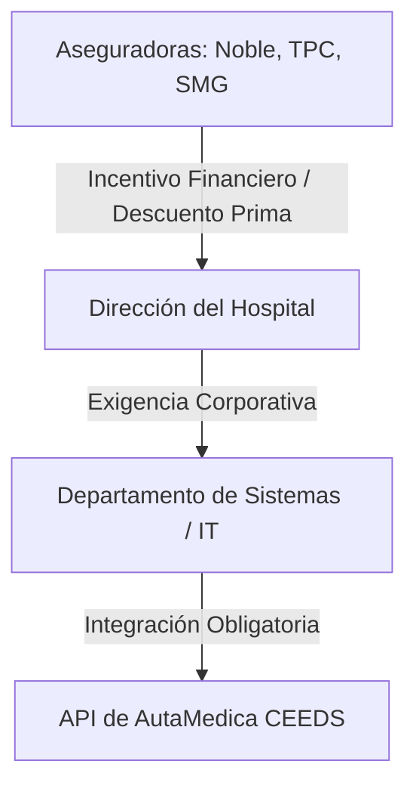

# CEEDS Forensic Audit Playbook: Estrategia de Defensa Médica y Mitigación Judicial

> **Fuente de verdad estratégica y arquitectura forense para la defensa de prestadores de salud (p. ej., Hospital Italiano) y aseguradoras de mala praxis (Noble, TPC, SMG Seguros) en los Tribunales de la República Argentina.**

---

## 1. El Contexto Judicial: El Error de Proceso como Vulnerabilidad

En el fuero civil y comercial de la Ciudad Autónoma de Buenos Aires (CABA), la inmensa mayoría de las condenas por mala praxis médica no se dictan por **impericia científica** del médico (error insalvable en el diagnóstico), sino por **negligencia u omisión en el proceso operativo (incumplimiento de la Lex Artis y defecto de registro)**.

Los estudios boutique especializados en Derecho de Daños (Lavorato, Vadell, etc.) explotan sistemáticamente tres grietas del ecosistema clínico y de su Historia Clínica Electrónica (HCE) "blanda":

1.  **Baches y Carga Asincrónica en HCE:** Anotaciones de evolución escritas horas después del evento o ausencia total de registros basales de signos vitales. Esto genera una _presunción judicial de culpa por omisión_.
2.  **Inexistencia de Trazabilidad Metrológica del Hardware (ANMAT):** Si un respirador descalibrado, una bomba de infusión con falla técnica o un desfibrilador defectuoso intervienen en un evento adverso, y el sanatorio no posee un **registro inmutable de la calibración vigente del dispositivo en ese exacto micro-momento**, los jueces imponen _responsabilidad objetiva automática_ a la institución y su aseguradora.
3.  **Firma y Cierre Arbitrario del Alta:** Casos donde se firma el alta de un paciente con dolor torácico o cefalea sin descartar banderas rojas por algoritmo (p. ej., descartar rotura de aneurisma por GCS/VAS o infarto por troponina cinética) por simple colapso de la guardia.

---

## 2. Los Tres Pilares de Defensa Forense de CEEDS v2.2

La infraestructura de **AutaMedica (CEEDS v2.2)** transforma la HCE de una simple herramienta de carga rápida en un **acta notarial de cumplimiento de la Lex Artis y trazabilidad técnica**.

```
[Datos Fisiológicos / Evento Biomédico]
                  |
                  v
       [CEEDS Validation Layer]
   * Regla 1: Inmutabilidad por Trigger DB (Ley 27.706)
   * Regla 2: Metrología ANMAT Lockout
   * Regla 3: Gate de Cierre SOAP por Banderas Rojas
                  |
                  v
[Dossier de Certificación de Lex Artis (Signed PDF/JSON)]
```

### Pilar 1: Inmutabilidad Absoluta del Registro Clínico (Ley 27.706 & HIPAA)

Bajo la Ley 27.706 de Historias Clínicas Digitales en Argentina, el registro de eventos debe ser inalterable. CEEDS enforza esto directamente en el motor de base de datos a través de triggers de inmutabilidad en la tabla `clinical_incident_events` y `equipment_events`:

```sql
CREATE TRIGGER trg_clinical_incident_events_immutable
BEFORE UPDATE OR DELETE ON public.clinical_incident_events
FOR EACH STATEMENT EXECUTE FUNCTION public.prevent_audit_mutation();
```

- **Consecuencia Forense:** Cualquier perito informático judicial que audite nuestra base de datos certificará que **los registros de evolución clínica y telemetría son técnicamente imposibles de adulterar o borrar**, destruyendo el argumento común de la querella sobre la "alteración maliciosa o extemporánea de registros".

### Pilar 2: Trazabilidad Metrológica de Equipamiento en Tiempo Real (Norma ANMAT)

CEEDS implementa un **bloqueo estricto por software (lockout)** que impide que cualquier dispositivo médico (p. ej., respirador, desfibrilador) sea seleccionado para un procedimiento o paciente si:

- Su fecha límite de calibración (`next_calibration_due`) ha expirado.
- Su estado dentro de la FSM de CEEDS no es `'active'`.
- Para pasar del estado `'validation_pending'` a `'active'`, el sistema exige obligatoriamente un **certificado de calibración metrológica firmado y trazable** (`calibration_certificate_url`).

- **Consecuencia Forense:** En caso de demanda por falla de aparatología, la aseguradora presenta el **Dossier Técnico Metrológico de CEEDS** con el hash del certificado de calibración vigente a la milésima de segundo del incidente. Esto demuestra la debida diligencia de la institución y desplaza la carga de la prueba.

### Pilar 3: Cierre Clínico Gated por Algoritmo de Banderas Rojas

Un médico de guardia no puede cerrar un incidente ni firmar el alta de forma subjetiva. El endpoint `POST /api/doctors/clinical-safety-close-incident` ejecuta la validación automatizada de la Lex Artis en backend:

- **En Cefalea (R51):** Obliga a reportar Escala de Dolor (VAS < 3) y verificar negativamente el screening completo de **Red Flags** (onset súbito de trueno, déficits focalizados, meningismo, inmunodeficiencia).
- **En IAM (I21):** Exige curva cinética troponínica descendente/meseta verificada por código (mínimo 2 muestras ordenadas cronológicamente) y reducción $\ge 50\%$ de la elevación del segmento ST respecto al pico máximo.
- **Retorno 409 Conflict:** Si las condiciones no se satisfacen, CEEDS aborta la transacción y mantiene el incidente como _escalado_, alertando al jefe de servicio.

- **Consecuencia Forense:** Si el paciente sufre una complicación posterior en su domicilio, el sanatorio tiene la prueba irrefutable de que **el alta médica se otorgó bajo estrictos parámetros fisiológicos objetivos y protocolos internacionales**, eximiendo al sanatorio de culpa por negligencia o descuido.

---

## 3. Plan de Acción: La Venta de "Blindaje Forense" a Aseguradoras

Para hackear la burocracia de los sanatorios y los departamentos de sistemas, la penetración comercial se realiza desde el vector del **riesgo financiero**.



### 3.1 El Discurso de Guerra para la Aseguradora

1.  **El Costo del Silencio:** _"Ustedes pagan millones en mediaciones extrajudiciales porque los registros de sus asegurados son blandos. Los peritos de estudios como Lavorato destrozan el registro de enfermería porque es modificable y asincrónico."_
2.  **La Solución AutaMedica:** _"No venimos a vender un software de gestión médica tradicional. Venimos a vender un **sistema de blindaje forense**. CEEDS bloquea en código el error humano antes de que ocurra, y genera un acta digital de cumplimiento pericial firmada criptográficamente en cada procedimiento."_
3.  **El Modelo de Integración por Incentivo:** Las aseguradoras ofrecen una reducción de la prima de seguro de mala praxis institucional a aquellos hospitales que tengan implementado el **motor de cumplimiento CEEDS v2.2** en su HCE.

---

## 4. Estructura del Certificado de Cumplimiento de Lex Artis

El sistema expone un endpoint forense que emite el **Dossier de Cumplimiento de Lex Artis** en formato PDF y JSON firmado digitalmente. Este reporte resume toda la evidencia objetiva inmutable para su presentación en tribunales o mediaciones.

### Estructura de Respuesta JSON Forense

```json
{
  "dossier_identity": {
    "dossier_id": "DOS-CEEDS-2026-0525-4A9B",
    "timestamp": "2026-05-25T17:15:00.000Z",
    "clinical_incident_id": "8c4bc710-47b2-4d2c-88c9-de8b0301a91e",
    "patient_identity_hash": "SHA256-42d8f99e31a8...",
    "responsible_physician": {
      "name": "Dr. Carlos Zalazar",
      "national_license": "MN-142859",
      "refeps_id": "REF-99281-AR"
    }
  },
  "clinical_lex_artis_evidence": {
    "diagnosis": "Infarto Agudo de Miocardio (IAM)",
    "cie10_code": "I21.9",
    "snomed_concept_id": "57054005",
    "safety_gating_status": "ALLOW_CLOSURE",
    "evidence_metrics": {
      "st_resolution_achieved": true,
      "peak_st_elevation_mm": 3.2,
      "immediate_st_elevation_mm": 1.1,
      "reduction_ratio_pct": 65.6,
      "required_reduction_pct": 50.0,
      "troponin_kinetic_slope": "descending",
      "samples": [
        { "timestamp": "2026-05-25T11:00:00Z", "value_ng_ml": 7.4 },
        { "timestamp": "2026-05-25T14:00:00Z", "value_ng_ml": 5.1 }
      ]
    },
    "closure_authorization": {
      "authorized_by": "usr-8f2c00a1",
      "timestamp": "2026-05-25T14:15:22Z",
      "notes": "ECG post-angioplastia evidencia reperfusión exitosa con ST resuelto > 50%. Cinética enzimática en franca declinación. Sin angina residual."
    }
  },
  "biomedical_equipment_traceability": {
    "device_used": {
      "brand": "Dräger",
      "model": "Evita V800",
      "serial_number": "SN-DRG-992815",
      "device_type": "ventilator",
      "snomed_device_code": "450637000"
    },
    "metrological_compliance": {
      "calibration_status_at_incident": "active",
      "last_calibrated_at": "2026-03-10T09:00:00Z",
      "next_calibration_due": "2026-09-06T09:00:00Z",
      "operating_hours": 1420.5,
      "calibration_certificate_reference_url": "https://vault.autamedica.com/certificates/drg-992815-20260310.pdf"
    }
  },
  "immutability_security_seal": {
    "blockchain_proof_hash": "0x5f3e9c1ad700941a78ee9d0092149bde7c10b42f6aa8d89a2e310bbcd772ef91",
    "trigger_audit_version": "PG-TRG-CEEDS-2.2",
    "integrity_check": "SUCCESS"
  }
}
```

Este dossier es un arma judicial demoledora. Ningún perito del querellante puede contradecir datos duros automatizados de telemetría médica correlacionados con calibración vigente oficial de marcas homologadas y firmas del REFEPS/colegio médico.
