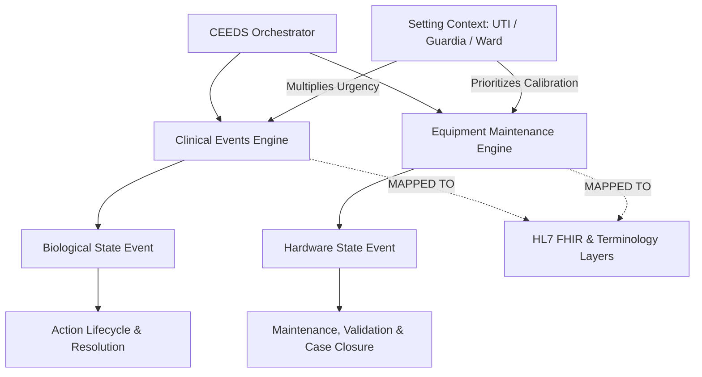
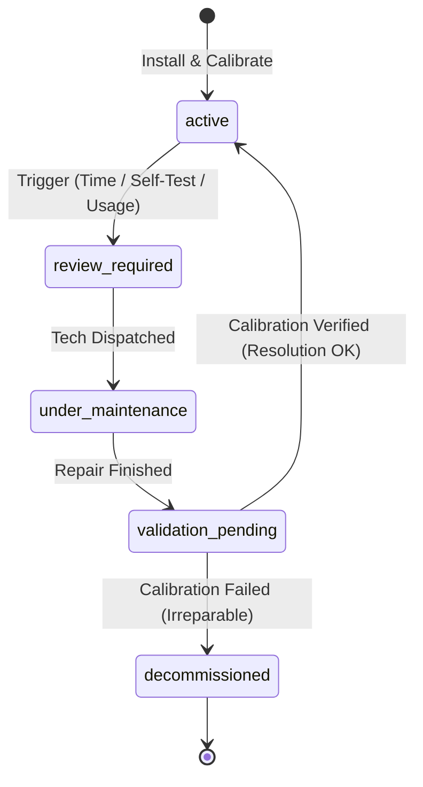

# Clinical & Equipment Event-Driven System (CEEDS) Design

## Source of Truth & Technical Research Model

### Version 2.0 - Clinical & Interoperability Hardening

This document serves as the architectural blueprint and clinical research source for the **Clinical & Equipment Event-Driven System (CEEDS)** in AutaMedica. It details how the platform tracks, escalates, and resolves clinical conditions and medical equipment lifecycles based on severity, clinical setting (UTI vs. Emergency Guardia), and medical evidence.

---

## 1. Core Architectural Concepts

A modern clinical telemetry and operations platform must separate and correlate two distinct planes: **Clinical Events** (events affecting the patient's biological state) and **Equipment Events** (events affecting the status of life-support and diagnostic machinery). Both are highly dependent on the **Clinical Setting** (Entorno Clínico) which acts as a multiplier of urgency.



### 1.1 Setting Context as an Urgency Multiplier

In medical informatics, a clinical variable or warning does not exist in a vacuum. It is heavily context-dependent:

- **UTI (Unidad de Terapia Intensiva / ICU):** Continuous monitoring. Extreme density of life-support devices. The tolerance for delay (SLA) is measured in **seconds or minutes**. Any anomaly represents high mortality risk.
- **Guardia (Emergency Room / ER):** Fast-paced, high turnover. The tolerance for delay is measured in **minutes** (e.g., triage prioritization). Devices are dynamic (defibrillators, mobile monitors).
- **Piso / Sala Común (General Ward):** Intermittent monitoring (nursing rounds every 4–6 hours). Tolerance for delay is measured in **hours**.
- **Ambulatorio (Outpatient):** Home monitoring or scheduling. Tolerance for delay is measured in **days or weeks**.

---

## 2. Clinical Condition Urgency & SLA Matrix

The resolution lifecycle of a condition changes radically depending on the pathology and setting. The system represents this through customized State Transitions and strict SLA constraints.

### 2.1 Contrast Study: Cefalea (Headache) vs. IAM (Acute Myocardial Infarction)

| Clinical Attribute       | Cefalea (Headache)                                                                          | IAM (Infarto Agudo de Miocardio)                                                                                                                                |
| :----------------------- | :------------------------------------------------------------------------------------------ | :-------------------------------------------------------------------------------------------------------------------------------------------------------------- |
| **Typical Setting**      | Ambulatorio / Guardia (Triage Verde/Amarillo)                                               | UTI / Guardia (Triage Rojo / Shockroom)                                                                                                                         |
| **Time-to-Action (SLA)** | **< 120 minutes (2 hours)** for initial evaluation.                                         | **< 2 minutes** for high-priority telemetry triggers; **< 10 minutes** for diagnostic ECG; **< 90 minutes** for Angioplasty (Door-to-Balloon).                  |
| **Monitored Metrics**    | Subjective Pain Scale (VAS), Blood Pressure, Neurological examination, Red Flags screening. | ST-Segment Elevation (ECG), Troponin levels (kinetic slope), Oxygen Saturation, Heart Rate.                                                                     |
| **State transitions**    | `onset` → `medicated` → `pain_reduced` → `resolved`                                         | `suspected` → `confirmed` → `reperfused` → `post_op_uti` → `stabilized` → `resolved`                                                                            |
| **Verification Trigger** | Re-evaluation every **30-60 minutes** post-analgesic.                                       | Continuous (every **1-5 minutes** via telemetry).                                                                                                               |
| **Resolution Criteria**  | VAS Pain Scale < 3/10 AND negative **Red Flags** screening.                                 | Patency of coronary artery, **relative ST resolution $\ge 50\%$**, stabilized troponin kinetic clearance curve, stable hemodynamics without vasoactive support. |

### 2.2 Advanced Resolution Logic

#### 2.2.1 Infarto Agudo de Miocardio (IAM)

Using a single absolute threshold like _troponin normal levels_ or _ST elevation < 0.5 mm_ is clinically invalid. In real-world cardiology:

- **Troponin Kinetics:** Troponin levels remain elevated for days after myocardial damage. Thus, resolution relies on establishing a **kinetic trend** (a verified downward trend or plateau in successive measurements separated by 3–6 hours), indicating that active necrosis has ceased.
- **Relative ST-Segment Resolution:** Reperfusion success is determined by a relative ST-segment resolution of **$\ge 50\%$** (measured at 60–90 minutes post-intervention compared to the peak pre-intervention ECG), rather than an arbitrary absolute residual value.

#### 2.2.2 Cefalea (Headache) Red Flags

Before resolving a headache case, the system enforces a diagnostic checklist to rule out high-mortality secondary headaches. The system blocks resolution if any of the following **Red Flags** are flagged:

1.  _Thunderclap onset:_ Pain reaching peak intensity within 1 minute (suggests Subarachnoid Hemorrhage).
2.  _Focal Neurological Deficits:_ New motor weakness, sensory loss, or visual disturbance.
3.  _Meningism:_ Neck stiffness, photophobia, or fever.
4.  _Atypical presentation:_ Patient $>50$ years old with new-onset headache, or immunodeficient status.

### 2.3 Multidimensional Setting-Pathology Matrix

> [!IMPORTANT]
> **The Location Rule:** If a patient with a low-urgency condition (e.g., Cefalea) is admitted to the **UTI**, the condition inherits a **high-priority telemetry status** due to the patient's critical baseline. Conversely, a high-urgency condition (e.g., suspected IAM) in the **Guardia** instantly triggers a **Shockroom Escalation Event**.

```
Setting      | Condition   | SLA to ECG/Telemetry   | Verification Freq | Resolution Criterias
------------ | ----------- | ----------------------- | ----------------- | -------------------------------------
UTI          | IAM         | Immediate (< 2 mins)    | Continuous        | Reperfusion (ST red. >=50%) + Hemodyn OK
Guardia      | IAM         | < 10 mins (ECG)         | Every 5 mins      | Reperfusion / UTI Transfer
UTI          | Cefalea     | < 30 mins               | Every 30 mins     | Pain relief (VAS < 3) + No Red Flags
Piso / Ward  | Cefalea     | < 120 mins              | Every 2 hours     | Pain relief (VAS < 3) + No Red Flags
```

---

## 3. Equipment Revision & Calibration Lifecycle

Medical hardware lifecycles are modeled as strict finite state machines (FSM) to ensure patient safety and legal compliance (e.g., **ANMAT** in Argentina).



### 3.1 Lifecycle States of a Device:

1.  **`active` (Operativo):** Calibrated and safe for patient use.
2.  **`review_required` (Revisión Necesaria):** Triggered by operating hours limit, calendar deadline, or software warning.
3.  **`under_maintenance` (En Mantenimiento):** Technical crew dispatched; device locked from patient scheduling.
4.  **`validation_pending` (Validación Pendiente):** Physical repair complete; awaiting official metrology/calibration verification.
5.  **`decommissioned` (Decomisado / Fuera de Servicio):** Fails verification, deprecated, or unsafe.

### 3.2 ANMAT & Metrological Traceability

Every active medical device in the system must preserve a record of metrological calibration, linking to certified patterns traceable to national standards (e.g., INTI in Argentina). The system enforces that:

- A device in `validation_pending` cannot be transitioned back to `active` without attaching an signed metrology certificate.
- Automated countdowns block the equipment vector the moment `next_calibration_due` is breached.

---

## 4. PostgreSQL Relational Database Schema Design

This schema implements strict type-safety, constraints, and audit capabilities using PostgreSQL best practices. To support healthcare interoperability, it incorporates mappings to standard resources (**HL7 FHIR**) and medical terminologies (**SNOMED CT** and **LOINC**).

```sql
-- 1. Create custom types/enums for settings and severities
CREATE TYPE public.clinical_setting AS ENUM ('uti', 'guardia', 'ward', 'outpatient');
CREATE TYPE public.incident_severity AS ENUM ('critical', 'high', 'medium', 'low');
CREATE TYPE public.medical_order_status AS ENUM ('draft', 'signed', 'cancelled', 'expired');
CREATE TYPE public.equipment_status AS ENUM ('active', 'review_required', 'under_maintenance', 'validation_pending', 'decommissioned');

-- 2. Patients & Clinical Incidents Schema
-- Maps directly to HL7 FHIR: Condition & Encounter
CREATE TABLE IF NOT EXISTS public.clinical_incidents (
  id UUID PRIMARY KEY DEFAULT gen_random_uuid(),
  created_at TIMESTAMPTZ NOT NULL DEFAULT now(),
  updated_at TIMESTAMPTZ NOT NULL DEFAULT now(),
  patient_id UUID NOT NULL REFERENCES public.patients(id),
  doctor_id UUID NOT NULL REFERENCES public.doctors(id),

  -- Terminology Alignment: SNOMED CT and CIE-10
  condition_code TEXT NOT NULL,          -- CIE-10 code (e.g., 'I21.9' for IAM, 'R51' for Cefalea)
  snomed_concept_id TEXT NOT NULL,       -- SNOMED CT ID (e.g., '57054005' for Acute Myocardial Infarction)
  condition_display TEXT NOT NULL,       -- Human-readable clinical label

  setting clinical_setting NOT NULL DEFAULT 'outpatient',
  severity incident_severity NOT NULL DEFAULT 'medium',
  status TEXT NOT NULL DEFAULT 'open' CHECK (status IN ('open', 'escalated', 'resolved', 'closed')),

  diagnosed_at TIMESTAMPTZ NOT NULL,
  resolved_at TIMESTAMPTZ,
  sla_deadline TIMESTAMPTZ NOT NULL,     -- Calculated automatically on trigger
  resolution_notes TEXT,
  closed_by UUID REFERENCES public.profiles(user_id)
);

-- 3. Clinical State Transitions Audit Log (Event Sourcing light)
-- IMMUTABLE / APPEND-ONLY. Maps to HL7 FHIR: AuditEvent
CREATE TABLE IF NOT EXISTS public.clinical_incident_events (
  id UUID PRIMARY KEY DEFAULT gen_random_uuid(),
  incident_id UUID NOT NULL REFERENCES public.clinical_incidents(id) ON DELETE CASCADE,
  timestamp TIMESTAMPTZ NOT NULL DEFAULT now(),
  actor_id UUID NOT NULL REFERENCES public.profiles(user_id),
  from_status TEXT NOT NULL,
  to_status TEXT NOT NULL,
  event_description TEXT NOT NULL,

  -- Contains telemetry & clinical indicators mapped with LOINC
  -- Example: { "loinc_85805_2": 85.0 } for ECG ST segment elevation
  clinical_evidence JSONB NOT NULL
);

-- 4. Medical Equipment Schema
-- Maps directly to HL7 FHIR: Device & DeviceMetric
CREATE TABLE IF NOT EXISTS public.medical_equipment (
  id UUID PRIMARY KEY DEFAULT gen_random_uuid(),
  serial_number TEXT UNIQUE NOT NULL,
  model_name TEXT NOT NULL,
  brand TEXT NOT NULL,
  device_type TEXT NOT NULL,             -- "infusion_pump", "ventilator", "defibrillator"
  current_status equipment_status NOT NULL DEFAULT 'active',
  current_setting clinical_setting NOT NULL DEFAULT 'ward',
  installed_at TIMESTAMPTZ NOT NULL DEFAULT now(),
  last_calibrated_at TIMESTAMPTZ NOT NULL,
  next_calibration_due TIMESTAMPTZ NOT NULL,
  operating_hours NUMERIC(10, 2) NOT NULL DEFAULT 0.0,
  organization_id UUID NOT NULL REFERENCES public.organizations(id),

  -- Interoperability binding
  snomed_device_code TEXT                -- SNOMED CT physical object code (e.g. '450637000' for Ventilator)
);

-- 5. Equipment Maintenance Tickets (Incidents)
CREATE TABLE IF NOT EXISTS public.equipment_incidents (
  id UUID PRIMARY KEY DEFAULT gen_random_uuid(),
  equipment_id UUID NOT NULL REFERENCES public.medical_equipment(id) ON DELETE CASCADE,
  reporter_id UUID NOT NULL REFERENCES public.profiles(user_id),
  assigned_technician_id UUID REFERENCES public.profiles(user_id),
  severity incident_severity NOT NULL DEFAULT 'medium',
  status TEXT NOT NULL DEFAULT 'open' CHECK (status IN ('open', 'in_progress', 'resolved', 'closed')),
  reported_at TIMESTAMPTZ NOT NULL DEFAULT now(),
  resolved_at TIMESTAMPTZ,
  next_verification_due TIMESTAMPTZ,     -- When it must be verified again
  technical_summary TEXT,
  calibration_certificate_url TEXT,       -- Verification metrological artifact
  closed_at TIMESTAMPTZ
);

-- 6. Equipment Action Events
-- IMMUTABLE / APPEND-ONLY. Maps to HL7 FHIR: AuditEvent
CREATE TABLE IF NOT EXISTS public.equipment_events (
  id UUID PRIMARY KEY DEFAULT gen_random_uuid(),
  incident_id UUID NOT NULL REFERENCES public.equipment_incidents(id) ON DELETE CASCADE,
  timestamp TIMESTAMPTZ NOT NULL DEFAULT now(),
  actor_id UUID NOT NULL REFERENCES public.profiles(user_id),
  action_type TEXT NOT NULL,             -- "diagnose", "repair", "calibrate", "verify", "close"
  is_resolved BOOLEAN NOT NULL DEFAULT false,
  notes TEXT NOT NULL
);

-- 7. Audit Immutability Enforcement (Triggers)
-- Legally required under Argentina Law 27.706 and HIPAA for audit trail integrity
CREATE OR REPLACE FUNCTION public.prevent_audit_mutation()
RETURNS TRIGGER AS $$
BEGIN
  RAISE EXCEPTION 'CEEDS Audit logs are immutable. UPDATE and DELETE operations are forbidden.'
    USING ERRCODE = 'destructive_operation_prevented';
END;
$$ LANGUAGE plpgsql;

CREATE TRIGGER trg_clinical_incident_events_immutable
BEFORE UPDATE OR DELETE ON public.clinical_incident_events
FOR EACH STATEMENT EXECUTE FUNCTION public.prevent_audit_mutation();

CREATE TRIGGER trg_equipment_events_immutable
BEFORE UPDATE OR DELETE ON public.equipment_events
FOR EACH STATEMENT EXECUTE FUNCTION public.prevent_audit_mutation();

-- 8. Add indexes for performance & fast query telemetry
CREATE INDEX idx_clinical_incidents_patient ON public.clinical_incidents(patient_id);
CREATE INDEX idx_clinical_incidents_status ON public.clinical_incidents(status) WHERE status = 'open';
CREATE INDEX idx_medical_equipment_due ON public.medical_equipment(next_calibration_due);
CREATE INDEX idx_equipment_incidents_open ON public.equipment_incidents(status) WHERE status = 'open';
```

---

## 5. TypeScript Domain Types & Interfaces

Strict TypeScript implementation model without `any`.

```typescript
export type UUID = string;
export type ISODateString = string;

export type ClinicalSetting = "uti" | "guardia" | "ward" | "outpatient";
export type IncidentSeverity = "critical" | "high" | "medium" | "low";
export type ClinicalIncidentStatus = "open" | "escalated" | "resolved" | "closed";

export interface ClinicalIncident {
  id: UUID;
  createdAt: ISODateString;
  updatedAt: ISODateString;
  patientId: UUID;
  doctorId: UUID;
  conditionCode: string; // CIE-10
  snomedConceptId: string; // SNOMED CT Concept identifier
  conditionDisplay: string;
  setting: ClinicalSetting;
  severity: IncidentSeverity;
  status: ClinicalIncidentStatus;
  diagnosedAt: ISODateString;
  resolvedAt: ISODateString | null;
  slaDeadline: ISODateString;
  resolutionNotes: string | null;
  closedBy: UUID | null;
}

export interface TroponinMeasurement {
  timestamp: ISODateString;
  valueNgMl: number; // Mapped to LOINC: 10839-9
}

export interface ClinicalEvidence {
  painScaleVas?: number; // Visual Analogue Scale 0-10
  ecgStElevationMm?: number; // Mapped to LOINC: 85805-2 (ECG elevation in mm)
  peakEcgStElevationMm?: number; // Pre-intervention peak for relative ST evaluation
  troponinHistory?: TroponinMeasurement[];
  oxygenSaturationPct?: number; // Mapped to LOINC: 2708-6
  glasgowComaScale?: number; // Mapped to LOINC: 9269-2

  // Headache Red Flags Screening Checklist
  hasThunderclapOnset?: boolean;
  hasNewFocalDeficits?: boolean;
  hasMeningism?: boolean;
  isImmunodeficient?: boolean;

  customParameters?: Record<string, string | number | boolean>;
}

export interface ClinicalIncidentEvent {
  id: UUID;
  incidentId: UUID;
  timestamp: ISODateString;
  actorId: UUID;
  fromStatus: ClinicalIncidentStatus;
  toStatus: ClinicalIncidentStatus;
  eventDescription: string;
  clinicalEvidence: ClinicalEvidence;
}

export type EquipmentStatus = "active" | "review_required" | "under_maintenance" | "validation_pending" | "decommissioned";
export type EquipmentIncidentStatus = "open" | "in_progress" | "resolved" | "closed";

export interface MedicalEquipment {
  id: UUID;
  serialNumber: string;
  modelName: string;
  brand: string;
  deviceType: string;
  currentStatus: EquipmentStatus;
  currentSetting: ClinicalSetting;
  installedAt: ISODateString;
  lastCalibratedAt: ISODateString;
  nextCalibrationDue: ISODateString;
  operatingHours: number;
  organizationId: UUID;
  snomedDeviceCode: string | null;
}
```

---

## 6. Business Logic Validation & Dynamic SLAs

```typescript
/**
 * Calculates the strict SLA deadline for an incident based on setting and disease.
 * Aligns perfectly with standard clinical time-to-action protocols.
 */
export function calculateSlaDeadline(diagnosedAt: Date, conditionCode: string, setting: ClinicalSetting): Date {
  const deadline = new Date(diagnosedAt);

  // suspected Acute Myocardial Infarction (CIE-10: I21.*)
  if (conditionCode.startsWith("I21")) {
    if (setting === "uti") {
      deadline.setMinutes(deadline.getMinutes() + 5); // 5 mins SLA in ICU
    } else if (setting === "guardia") {
      deadline.setMinutes(deadline.getMinutes() + 10); // 10 mins SLA in ER (ECG door-to-evaluation target)
    } else {
      deadline.setMinutes(deadline.getMinutes() + 30);
    }
    return deadline;
  }

  // Cefalea (CIE-10: R51)
  if (conditionCode === "R51") {
    if (setting === "uti") {
      deadline.setMinutes(deadline.getMinutes() + 30); // elevated priority due to ICU ICU setting
    } else if (setting === "guardia") {
      deadline.setHours(deadline.getHours() + 2); // 2 hours
    } else {
      deadline.setHours(deadline.getHours() + 2); // Unified 2 hours for Piso/Ward
    }
    return deadline;
  }

  // Defaults
  deadline.setHours(deadline.getHours() + 12);
  return deadline;
}

/**
 * Validates if the clinical event meets the condition's closure criteria.
 * Replaces absolute, physiologically invalid gates with kinetic trend validation and red-flag checks.
 */
export function validateResolutionCriteria(conditionCode: string, evidence: ClinicalEvidence): { isValid: boolean; reason?: string } {
  // Headache (Cefalea) closure rules
  if (conditionCode === "R51") {
    if (evidence.painScaleVas === undefined) {
      return { isValid: false, reason: "Debe ingresar la escala de dolor (VAS) para resolver una cefalea." };
    }

    // Strict Red Flags Screening
    if (evidence.hasThunderclapOnset || evidence.hasNewFocalDeficits || evidence.hasMeningism || evidence.isImmunodeficient) {
      return {
        isValid: false,
        reason: "No se puede resolver: Se detectaron signos de alerta (Red Flags) que requieren exploración neurológica y derivación.",
      };
    }

    if (evidence.painScaleVas >= 3) {
      return { isValid: false, reason: `No se puede resolver: la escala de dolor es alta (${evidence.painScaleVas}/10).` };
    }
    return { isValid: true };
  }

  // Acute Myocardial Infarction (IAM) closure rules
  if (conditionCode.startsWith("I21")) {
    if (evidence.ecgStElevationMm === undefined || evidence.peakEcgStElevationMm === undefined || !evidence.troponinHistory || evidence.troponinHistory.length < 2) {
      return {
        isValid: false,
        reason: "Se requieren valores de ECG (pico e inmediato) e historial de troponina (mínimo 2 muestras) para verificar resolución.",
      };
    }

    // 1. Relative ST-Segment Resolution Verification
    // Success is defined as >= 50% reduction in ST elevation from pre-intervention peak
    const stReductionPct = ((evidence.peakEcgStElevationMm - evidence.ecgStElevationMm) / evidence.peakEcgStElevationMm) * 100;
    if (stReductionPct < 50) {
      return {
        isValid: false,
        reason: `El ECG no muestra una resolución de ST satisfactoria (Reducción: ${stReductionPct.toFixed(1)}% | Requerido >= 50%).`,
      };
    }

    // 2. Troponin Kinetic Trend Verification
    // Validate that troponin has passed the peak and exhibits a clear descending or plateau trend
    const history = [...evidence.troponinHistory].sort((a, b) => new Date(a.timestamp).getTime() - new Date(b.timestamp).getTime());

    const latest = history[history.length - 1].valueNgMl;
    const previous = history[history.length - 2].valueNgMl;

    if (latest > previous) {
      return {
        isValid: false,
        reason: `La cinética de troponina continúa en curva ascendente (${latest} > ${previous} ng/mL), lo que indica necrosis miocárdica activa.`,
      };
    }

    return { isValid: true };
  }

  return { isValid: true };
}
```

---

## 7. Alarm Governance & Fatigue Prevention

Clinical safety in telemetry requires avoiding "alarm fatigue"—the desensitization of medical staff due to excessive, non-actionable warnings. Aligned with the Joint Commission National Patient Safety Goals, CEEDS defines a multi-layered telemetry warning policy.

```
[Alarm Level] ----> Priority Tier ----> Action / Broadcast Scope
      |
      +---> Critical (Red)    ---> Local sound + Direct pager dispatch + Shockroom escalation
      +---> Warning (Yellow)  ---> Visual telemetry flash + Nursing desk audio notification
      +---> Technical (Blue)  ---> Dynamic equipment ticket creation + Silent dashboard warning
```

### 7.1 Alarm Categorization and Silencing

1.  **Red (Critical Alarms):** Heart rate anomalies ($>150$ or $<40$ bpm in UTI), extreme hypoxia ($SpO_2 < 85\%$), or un-calibrated life-support machines (e.g. active ventilator in repair).
    - _Silence Authority:_ Only active clinicians assigned to the patient session can silence a critical alarm.
    - _Silence Duration Limit:_ 2 minutes. If the alarm is silenced but the physiological values do not normalize within 120 seconds, the audio triggers automatically at maximum volume and escalates to the Department Chief.
2.  **Yellow (Warning Alarms):** Moderate physiological deviations, low battery warnings.
    - _Silence Authority:_ Assigned nurses or clinicians.
    - _Silence Duration Limit:_ 5 minutes.
3.  **Blue-Cyan (Technical Alarms):** Missing lead warnings, calibration due within 24 hours. Silent on telemetry dashboards, mapped to CMMS system alerts.

### 7.2 Patient-Adaptive Dynamic Baselines

To reduce false alarms, clinical limits are not hardcoded. The system evaluates the patient's baseline (e.g., a patient with chronic atrial fibrillation will have adjusted arrhythmia thresholds) preventing constant alerts. Adjusting baseline parameters requires explicit clinician authentication and logs an immutable `AuditEvent`.

---

## 8. Interoperability & Tecnovigilancia Framework

### 8.1 HL7 FHIR Interoperability Profile

For integration into national health grids (such as the Red Nacional de Salud Digital in Argentina), data structures are mapped directly to standard FHIR resources:

| CEEDS Entity                           | HL7 FHIR Resource         | Mapping Scope                                                          |
| :------------------------------------- | :------------------------ | :--------------------------------------------------------------------- |
| **`clinical_incidents`**               | `Condition` & `Encounter` | Clinical diagnosis binding, onset, severity, and context-setting.      |
| **`clinical_incident_events`**         | `Observation`             | Holds continuous telemetry, lab markers, and Glasgow scores.           |
| **`medical_equipment`**                | `Device` & `DeviceMetric` | Represents hardware instances, telemetry metrics, and operating hours. |
| **`clinical_incident_events` (Audit)** | `AuditEvent`              | Immutably tracks actors, actions, timestamps, and outcomes.            |

### 8.2 ANMAT-Aligned Tecnovigilancia Workflow

To comply with the post-marketing medical device surveillance regulations of the **ANMAT** (Argentina), CEEDS governs hardware adverse events through a dedicated pipeline:

```
[Equipment Failure Detected]
         |
         v
[Automatic Lockout (current_status = 'review_required')]
         |
         v
[Check Criticality: Patient Connected?]
  * Yes --> Trigger High-Priority Clinical Alert (Backup Device Requested)
  * No  --> Log Ticket & Dispatch Technician
         |
         v
[Generate Tecnovigilancia Report (XML/JSON)]
  * Auto-compile serial number, brand, logs, and clinical failure context.
  * Direct queue routing to Safety Vigilance Officer for ANMAT notification.
```

1.  **Clinical Intercept:** The system immediately blocks the execution of any patient session attempted on a device that is flagged with an active technical ticket, preventing legal liability and hazard.
2.  **Mandatory ANMAT Logging:** Technical tickets that resolve critical failures (e.g. defibrillator shock failure) are forced to compile a Tecnovigilancia report, ensuring full compliance and systematic reporting.

---

## 9. Production Operational Security & Safety Positioning

### 9.1 Transactional Outbox Pattern for Healthcare Reliability

In production, relying on standard in-memory event dispatchers (`InMemoryDomainEventsAdapter`) introduces unacceptable clinical risks (e.g., alert loss upon server restarts). To achieve clinical-grade reliability, CEEDS enforces a **Transactional Outbox Pattern**:

```
[Clinical Evidence Submitted]
             |
             v
 [Start DB Transaction]
   1. Insert clinical_rule_executions record
   2. Insert clinical_rule_overrides (if override occurred)
   3. Insert clinical_outbox_events (the pending payload to dispatch)
 [Commit DB Transaction]
             |
             +---> Fail ---> Rollback (All or nothing)
             v
 [Background Dispatch Worker (Cron / Queue)]
   1. Poll clinical_outbox_events where status = 'PENDING'
   2. Dispatch to external notifications, telemetry alerts, or WebSockets
   3. Update status = 'PROCESSED'
```

- **Transactional Outbox Schema:**
  ```sql
  CREATE TABLE IF NOT EXISTS public.clinical_outbox_events (
    id UUID PRIMARY KEY DEFAULT gen_random_uuid(),
    event_type TEXT NOT NULL,
    payload JSONB NOT NULL,
    status TEXT NOT NULL DEFAULT 'PENDING' CHECK (status IN ('PENDING', 'PROCESSED', 'FAILED')),
    created_at TIMESTAMPTZ NOT NULL DEFAULT now(),
    processed_at TIMESTAMPTZ
  );
  ```

### 9.2 Alarm Idempotency and Fatigue Prevention

To prevent multiple duplicate telemetry warnings or notification runs (e.g., when cron validation scripts overlap), every alarm must be dispatched with an **Idempotency Key** structured as:
$$\text{Idempotency Key} = \text{incident\_id} + \text{rule\_id} + \text{trigger\_type} + \text{time\_window}$$
The dispatch layer verifies the existence of this key before broadcasting any visual or auditory alarms, ensuring that patients and staff are protected from alert noise and fatigue.

### 9.3 Definitive Legal & Technical Positioning

CEEDS is strictly positioned not as an autonomous medical decision engine, but as an institutional audit and compliance shield:

> **AutaMedica implements an event-driven Clinical Safety & Rule Traceability Engine, transforming symptoms, diagnoses, clinical evidence, red flags, and re-evaluation windows into auditable, trackable actions for tracking, escalation, and assisted clinical closure.**

This positioning ensures full compliance with ANMAT, Ley 27.706 (HCE Argentina), and HIPAA security controls while shifting diagnostic liability entirely back to the responsible medical physician.
