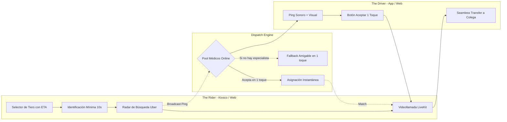
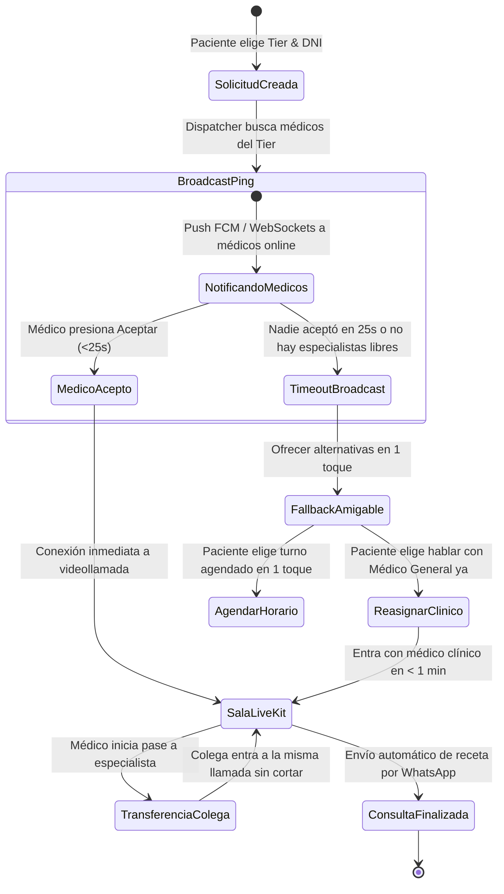

# AutaMedica On-Demand: Arquitectura de Flujo y Despacho Ágil ("Uber para Médicos")

> **Documento Rector de Experiencia de Usuario (UX), Arquitectura de Despacho y Desempeño Operativo.**  
> **Filosofía:** 100% No Restrictivo. Cero fricción. Enfoque puro en despacho instantáneo, transparencia y continuidad asistencial.

---

## 1. El Concepto Rector: La Salud al Ritmo de Uber

En los servicios de movilidad líderes en el mundo (Uber), el usuario nunca llena formularios de 20 preguntas ni enfrenta barreras punitivas antes de viajar:
1. Abre la app o se acerca al punto de partida.
2. Elige el **Tier de servicio** que necesita según su momento y presupuesto (UberX, Comfort, Black).
3. Conoce el tiempo estimado (ETA) en tiempo real antes de confirmar.
4. Presiona un botón. El sistema despacha al conductor más cercano y disponible.
5. El conductor recibe un ping sonoro y visual, acepta en **1 toque** y la experiencia comienza.

En **AutaMedica**, los "autos" son nuestros profesionales de la salud y las "terminales de abordaje" son los **Kioscos Inteligentes** y la **Web/Mobile App**. El paciente nunca es sometido a interrogatorios persecutorios ni a demoras burocráticas: solicita atención, el despachador empareja al profesional en segundos y la videoconsulta arranca de inmediato.



---

## 2. Flujo del Paciente (The Rider App: Kiosco & Web)

El recorrido del paciente está diseñado para completarse en **menos de 30 segundos** antes de estar frente al médico.

### Pantalla 1: Selector de Tiers de Atención (Bienvenida Visual)
En la pantalla de inicio del kiosco (o de la web), el paciente ve los distintos niveles de atención como tarjetas grandes, legibles y táctiles, cada una con su disponibilidad y tiempo estimado de espera (ETA) en tiempo real.

```text
┌───────────────────────────────────────────────────────────────────────┐
│  ➕ AUTAMEDICA                                     🕒 10:42 AM  ES | PT│
│  ¿Qué atención necesitas hoy?                                         │
│                                                                       │
│  ┌─────────────────────────────────────────────────────────────────┐  │
│  │ 🩺 Guardia Clínica General (UberX)            ⚡ Espera: < 2 min │  │
│  │    Fiebre, malestares, gripe, dolor común, recetas y certificados│  │
│  │    🟢 5 médicos online listos ya              [ Atenderme Ya → ]│  │
│  └─────────────────────────────────────────────────────────────────┘  │
│                                                                       │
│  ┌─────────────────────────────────────────────────────────────────┐  │
│  │ ❤️ Cardiología & Vascular (Uber Black)        ⚡ Espera: ~4 min │  │
│  │    Presión arterial, palpitaciones, control cardiovascular       │  │
│  │    🟢 2 cardiólogos de guardia activa         [ Solicitar → ]   │  │
│  └─────────────────────────────────────────────────────────────────┘  │
│                                                                       │
│  ┌─────────────────────────────────────────────────────────────────┐  │
│  │ 🧠 Salud Mental & Apoyo (Uber Comfort)        ⚡ Espera: ~5 min │  │
│  │    Ansiedad, contención, psiquiatría y seguimiento de medicación│  │
│  │    🟢 3 profesionales disponibles             [ Solicitar → ]   │  │
│  └─────────────────────────────────────────────────────────────────┘  │
│                                                                       │
│  ┌─────────────────────────────────────────────────────────────────┐  │
│  │ 👶 Pediatría Inmediata                        ⚡ Espera: ~3 min │  │
│  │    Atención para bebés, niños y adolescentes                     │  │
│  │    🟢 2 pediatras en línea                    [ Solicitar → ]   │  │
│  └─────────────────────────────────────────────────────────────────┘  │
└───────────────────────────────────────────────────────────────────────┘
```

#### Características Clave:
- **Transparencia Radical:** El paciente sabe antes de apretar si va a esperar 1 minuto o 4 minutos.
- **Sin Categorías Ocultas:** Todo el catálogo de atención está disponible de forma directa.
- **Micro-interacción Táctil:** En kiosco, botones con feedback visual de alto contraste y sonido agradable.

---

### Pantalla 2: Identificación Mínima (10 Segundos)
Sin contraseñas largas ni validaciones engorrosas. Solo dos datos: para saber quién es y para enviarle su receta digital o resumen médico al finalizar.

```text
┌───────────────────────────────────────────────────────────────────────┐
│  ← Volver a especialidades                                            │
│                                                                       │
│  Ingresá tus datos para conectar con el médico                        │
│                                                                       │
│  [  Escanear DNI en el lector óptico del Kiosco (1 segundo)  ]        │
│  ──────────────────────────── O ingresá a mano ────────────────────── │
│                                                                       │
│  Número de Documento (DNI / Pasaporte):                               │
│  ┌─────────────────────────────────────────────────────────────────┐  │
│  │ 32.456.789                                                      │  │
│  └─────────────────────────────────────────────────────────────────┘  │
│  Teléfono Celular (WhatsApp para enviarte tu receta):                  │
│  ┌─────────────────────────────────────────────────────────────────┐  │
│  │ +54 9 11 4567-8901                                              │  │
│  └─────────────────────────────────────────────────────────────────┘  │
│                                                                       │
│  Motivo principal (Opcional - 1 toque):                               │
│  [ Fiebre / Gripe ]  [ Presión / Pecho ]  [ Receta ]  [ Otro malestar ]│
│                                                                       │
│  ┌─────────────────────────────────────────────────────────────────┐  │
│  │             [ 🚀 CONECTAR CON EL MÉDICO AHORA ]                 │  │
│  └─────────────────────────────────────────────────────────────────┘  │
└───────────────────────────────────────────────────────────────────────┘
```

#### Optimización en Kiosco:
- **Lector de Código de Barras PDF417 / NFC:** Si el paciente apoya el DNI físico o su credencial de obra social/prepaga en la ranura del kiosco, el sistema lee y autocompleta nombre, apellido, sexo y DNI en 300 milisegundos. Solo resta confirmar el celular.

---

### Pantalla 3: Experiencia de Despacho & Radar (Uber Match Animation)
Inmediatamente tras presionar "Conectar", la pantalla entra en modo de búsqueda activa. La animación reproduce la confianza y dinamismo de Uber buscando vehículo en el mapa.

```text
┌───────────────────────────────────────────────────────────────────────┐
│                                                                       │
│                               ◎                                       │
│                           ◎       ◎                                   │
│                         ◎   ( 🩺 )   ◎                                │
│                           ◎       ◎                                   │
│                               ◎                                       │
│                                                                       │
│               Buscando un Cardiólogo disponible...                    │
│                                                                       │
│         Conectando con médicos de guardia en la red AutaMedica        │
│                           Espera estimada: 15s                        │
│                                                                       │
│  [ ✕ Cancelar solicitud ]                                             │
└───────────────────────────────────────────────────────────────────────┘
```

#### Transición de Match (< 10 segundos):
Cuando el médico acepta el caso, el radar se transforma en la tarjeta de confirmación del profesional:

```text
┌───────────────────────────────────────────────────────────────────────┐
│                                                                       │
│                         ✅ ¡Médico Asignado!                          │
│                                                                       │
│                     ┌───────────────────────────┐                     │
│                     │       [ FOTO MÉDICO ]     │                     │
│                     │                           │                     │
│                     │  Dr. Alejandro Rossi      │                     │
│                     │  Cardiólogo Universitario │                     │
│                     │  M.N. 142.890             │                     │
│                     └───────────────────────────┘                     │
│                                                                       │
│                  Ingresando a la consulta en 3, 2, 1...               │
│                                                                       │
└───────────────────────────────────────────────────────────────────────┘
```

---

### Pantalla 4: Sala de Consulta Instantánea (LiveKit Full-Bleed)
La transición a la videollamada es **continua, sin recarga de página (Single Page Transition)**.
- **Pantalla Completa (Full-Bleed):** El médico aparece en alta definición a pantalla completa.
- **Kiosco Hardware Dedicado:** Iluminación frontal integrada, cámara gran angular calibrada a la altura de los ojos, micrófono ambiental con cancelación de ruido y altavoces direccionales para privacidad acústica.
- **Finalización de Consulta:** El médico emite la receta electrónica homologada (SISA WS020 / Farmalink) o certificado y el paciente recibe una notificación automática por WhatsApp en su teléfono con el enlace seguro para descargarla.

---

## 3. Flujo del Médico (The Driver App: Android & Web)

El médico opera con la misma agilidad y simplicidad que un chofer de Uber: se conecta cuando está de guardia y atiende con un solo toque.

### 1. Estado "En Línea" (Toggle 1-Click)
- Interruptor principal: `[ En Servicio 🟢 ]` / `[ Desconectado ⚪ ]`.
- Contador de consultas realizadas durante el turno y saldo acumulado en tiempo real.

```text
┌───────────────────────────────────────────────────────────────────────┐
│  Dr. Alejandro Rossi                [ 🟢 En Servicio ]  $ 48.500 HOY  │
│  Guardia: Cardiología & Clínica General                               │
│                                                                       │
│  Estado: Listo para recibir consultas entrantes...                    │
│  (Pantalla a la espera de pings de despacho)                         │
└───────────────────────────────────────────────────────────────────────┘
```

### 2. Notificación Ping de Consulta Entrante (Incoming Call Ping)
Cuando un paciente solicita un turno de su categoría:
- **Sonido de Alerta Distintivo:** Timbre sonoro en bucle (prioridad alta).
- **Notificación en Primer Plano (Android & Web):** Overlay a pantalla completa que despierta la pantalla del móvil o toma foco en el navegador.

```text
┌───────────────────────────────────────────────────────────────────────┐
│                                                                       │
│                      🔔 NUEVA CONSULTA ENTRANTE                       │
│                                                                       │
│  Categoría:      ❤️ CARDIOLOGÍA DE GUARDIA                           │
│  Origen:         📍 Kiosco Terminal Central #1                       │
│  Paciente:       Eduardo M. (48 años)                                 │
│  Motivo:         "Palpitaciones y mareo leve tras esfuerzo"           │
│                                                                       │
│                       Tiempo para responder:                          │
│                             ┌───────┐                                 │
│                             │  18s  │                                 │
│                             └───────┘                                 │
│                                                                       │
│  ┌─────────────────────────────────────────────────────────────────┐  │
│  │                  [ ✅ ACEPTAR CONSULTA (1 TOQUE) ]              │  │
│  └─────────────────────────────────────────────────────────────────┘  │
│                                                                       │
│                     [ Rechazar / Pasar a otro colega ]                │
└───────────────────────────────────────────────────────────────────────┘
```

### 3. Consola Médica en Consulta
Al tocar "Aceptar", el médico entra a la sala LiveKit en menos de 800 ms. Su interfaz mantiene al paciente en el centro y ubica las herramientas en una barra perimetral no invasiva:
- **Ficha Rápida:** DNI, edad y motivo informado.
- **Receta Digital:** Generación de receta electrónica homologada en 2 clicks con plantillas precargadas.
- **Botón de Transferencia Asistida:** `[ 🔀 Derivar / Sumar a Colega ]`.

---

## 4. Motor de Despacho Ágil (Dispatch Engine)

El cerebro de despacho está diseñado para maximizar la velocidad de asignación y garantizar que **ningún paciente quede en un callejón sin salida**.



### A. Algoritmo de Asignación por Tier
1. **Pool Concurrente (Broadcast Flash):**
   - Cuando entra una consulta de Guardia General, se dispara una notificación simultánea a todos los médicos clínicos activos en el pool.
   - El primer profesional que presiona "Aceptar" gana la asignación atómica en la base de datos (Supabase RPC con lock optimista `SELECT FOR UPDATE SKIP LOCKED`).
   - El resto de los médicos reciben la cancelación silenciosa del ping sin generar fricción.
2. **Prioridad por Especialidad:**
   - Si el paciente eligió un Tier especializado (Cardiología, Pediatría, Salud Mental), el ping se remite exclusivamente a los especialistas calificados de esa rama.

---

### B. Fallback Inteligente y Amigable (Cero Callejones sin Salida)
Si todos los especialistas de ese Tier están ocupados o en llamada en ese segundo, el sistema **NUNCA** muestra un error ni dice "no hay turnos". Presenta inmediatamente dos alternativas claras y humanas en la pantalla del kiosco/web:

```text
┌───────────────────────────────────────────────────────────────────────┐
│                                                                       │
│         Nuestros cardiólogos están en consulta en este momento         │
│                                                                       │
│  ¿Cómo prefieres continuar?                                           │
│                                                                       │
│  ┌─────────────────────────────────────────────────────────────────┐  │
│  │  🩺 OPCIÓN 1: Hablar YA MISMO con un Médico Clínico de Guardia   │  │
│  │     Espera estimada: < 1 minuto                                 │  │
│  │     El médico clínico evaluará tus síntomas y, de ser necesario, │  │
│  │     te transferirá directamente con el cardiólogo durante la     │  │
│  │     misma llamada.                                              │  │
│  │                                                                 │  │
│  │                   [ ⚡ Ingresar con Clínico Ahora ]              │  │
│  └─────────────────────────────────────────────────────────────────┘  │
│                                                                       │
│  ┌─────────────────────────────────────────────────────────────────┐  │
│  │  📅 OPCIÓN 2: Reservar con el Cardiólogo en el próximo horario  │  │
│  │     Próximo turno libre: Hoy 11:30 hs (Dr. Roberto Gómez)       │  │
│  │     Te enviaremos el enlace directo a tu WhatsApp.              │  │
│  │                                                                 │  │
│  │                   [ 📲 Reservar Turno de las 11:30 ]            │  │
│  └─────────────────────────────────────────────────────────────────┘  │
│                                                                       │
└───────────────────────────────────────────────────────────────────────┘
```

---

### C. Botón "Pasar a Colega" (Seamless Transfer / Interconsulta en Vivo)
Esta es la función más potente del ecosistema: **un paciente nunca tiene que cortar la llamada y volver a hacer la fila**.

#### Caso de Uso Clínico:
1. El paciente entra a Guardia Clínica por dolor de pecho o palpitaciones.
2. El médico clínico lo atiende de inmediato, realiza la evaluación inicial y concluye: *"Quiero que el Dr. Rossi de cardiología vea este electro y evalúe tu caso ahora mismo"*.
3. El médico presiona el botón **`[ 🔀 Sumar / Derivar a Colega ]`** en su barra de herramientas.
4. Elige:
   - **`[ Tier: Cardiología ]`** (el despachador busca al primer cardiólogo disponible con prioridad de urgencia).
   - O selecciona a un colega específico online.
5. El sistema envía un ping de **Alta Prioridad** a los cardiólogos: *"Interconsulta en curso: Dr. Pérez solicita sumar especialista para paciente en Kiosco Central"*.
6. El cardiólogo acepta en 1 toque e **ingresa inmediatamente a la misma sesión de Cloudflare Calls SFU**.
7. Modalidades de pase:
   - **Transferencia Completa:** El médico clínico le resume el cuadro al cardiólogo en 15 segundos y sale de la llamada; el paciente continúa su consulta con el cardiólogo sin haber tocado ningún botón ni cortado el enlace RTP.
   - **Interconsulta Conjunta:** Ambos médicos conversan con el paciente simultáneamente gracias a la suscripción cruzada de tracks en Cloudflare Calls.

---

## 5. Arquitectura Técnica & Base de Datos (Supabase + Cloudflare Calls SFU)

### A. Modelo de Datos de Despacho (`dispatch_requests`)
Para orquestar los estados en milisegundos y con consistencia atómica:

```sql
-- Tabla central de despacho on-demand estilo Uber
CREATE TABLE IF NOT EXISTS public.dispatch_requests (
    id UUID PRIMARY KEY DEFAULT gen_random_uuid(),
    patient_id UUID REFERENCES auth.users(id),
    patient_dni TEXT NOT NULL,
    patient_phone TEXT NOT NULL,
    tier_requested TEXT NOT NULL, -- 'general', 'cardiologia', 'salud_mental', 'pediatria'
    kiosk_id TEXT,               -- ID de terminal física o NULL si es web
    symptom_chip TEXT,           -- 'dolor_pecho', 'fiebre', 'receta', etc.
    status TEXT NOT NULL DEFAULT 'searching', -- 'searching', 'matched', 'in_call', 'transferred', 'completed', 'cancelled'
    assigned_doctor_id UUID REFERENCES public.doctors(id),
    cloudflare_room_id TEXT UNIQUE NOT NULL,
    patient_cf_session_id TEXT,
    doctor_cf_session_id TEXT,
    created_at TIMESTAMPTZ NOT NULL DEFAULT NOW(),
    matched_at TIMESTAMPTZ,
    started_at TIMESTAMPTZ,
    ended_at TIMESTAMPTZ
);

-- Habilitar RLS y Realtime
ALTER TABLE public.dispatch_requests ENABLE ROW LEVEL SECURITY;
ALTER PUBLICATION supabase_realtime ADD TABLE public.dispatch_requests;
```

### B. Función RPC Atómica de Aceptación (Zero Race Conditions)
Evita que dos médicos tomen la misma consulta al mismo tiempo:

```sql
CREATE OR REPLACE FUNCTION public.accept_dispatch_request(
    p_request_id UUID,
    p_doctor_id UUID
)
RETURNS JSONB
LANGUAGE plpgsql
SECURITY DEFINER
AS $$
DECLARE
    v_request RECORD;
BEGIN
    -- Bloqueo de fila para evitar que dos médicos acepten simultáneamente
    SELECT * INTO v_request
    FROM public.dispatch_requests
    WHERE id = p_request_id AND status = 'searching'
    FOR UPDATE SKIP LOCKED;

    IF NOT FOUND THEN
        RETURN jsonb_build_object('success', false, 'error', 'La consulta ya fue tomada por otro colega o cancelada');
    END IF;

    -- Asignar médico y actualizar estado
    UPDATE public.dispatch_requests
    SET assigned_doctor_id = p_doctor_id,
        status = 'matched',
        matched_at = NOW()
    WHERE id = p_request_id;

    RETURN jsonb_build_object(
        'success', true,
        'cloudflare_room_id', v_request.cloudflare_room_id,
        'patient_dni', v_request.patient_dni
    );
END;
$$;
```

### C. Cloudflare Calls SFU Multi-Participant Seamless Transfer
- Cuando el médico clínico pulsa "Pasar a colega", el backend despacha la solicitud al cardiólogo entrante.
- El cardiólogo inicializa su sesión WebRTC contra Cloudflare Calls (`/sessions/new`), publica sus tracks locales y suscribe a los tracks remotos del paciente y del clínico (`/sessions/{sessionId}/tracks/new`).
- El cliente del paciente recibe el `sessionId` del cardiólogo vía Supabase Realtime y suscribe sus tracks sin refrescar ni desconectar la sesión WebRTC.
- El clínico se desconecta limpiamente ejecutando `tracks/close`, dejando al paciente y al cardiólogo enlazados directamente a través del SFU de Cloudflare.

---

## 6. Resumen de Ventajas Comparativas

| Factor | Modelo Tradicional de Telemedicina | Modelo AutaMedica On-Demand ("Uber Médicos") |
| :--- | :--- | :--- |
| **Tiempo de Espera** | 15 a 45 minutos en salas virtuales mudas. | **Menos de 2 minutos** (ETA visible de antemano). |
| **Fricción de Ingreso** | Formularios largos, passwords, cuestionarios previos. | **10 segundos** (DNI + WhatsApp, o escaneo óptico). |
| **Psicología de Espera** | Spinner de carga infinito sin información. | **Radar pulsante tipo Uber** con status en vivo. |
| **Aceptación Médica** | Listas de espera complejas en planillas. | **Ping sonoro de 1 toque** en app móvil o web. |
| **Falta de Especialista** | "No hay turnos disponibles, intente mañana". | **Fallback en 1 toque:** Clínico ya o reserva automática. |
| **Derivación Médica** | Cortar la llamada y pedir nuevo turno en días. | **Seamless Transfer:** El médico suma al especialista en vivo. |
