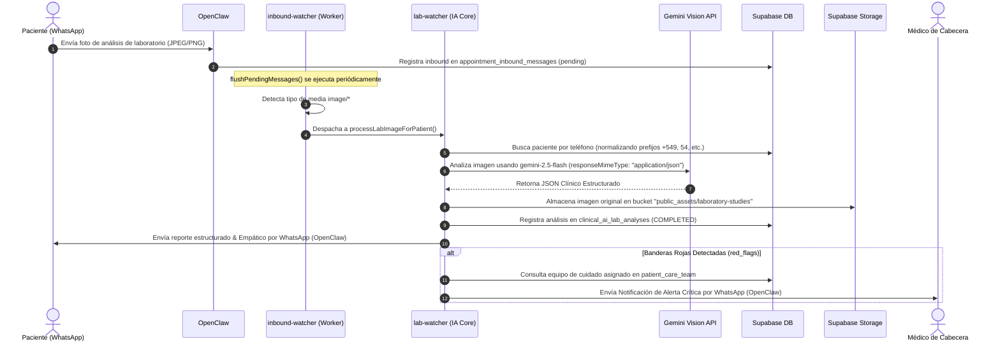

# 🩺 Pipeline de Ingesta y Diagnóstico Visual de Laboratorios (WhatsApp ➔ AI)

Este documento detalla la arquitectura, el flujo de datos y la implementación técnica del nuevo pipeline de **Ingesta y Diagnóstico Visual de Informes de Laboratorio** en la plataforma **AutaMedica**.

---

## 🚀 1. Arquitectura General y Flujo de Datos

El pipeline procesa de forma totalmente asíncrona informes de laboratorio clínico enviados como imágenes (`JPEG`, `PNG`) por los pacientes a través del canal oficial de WhatsApp (administrado por OpenClaw).



---

## 🗄️ 2. Estructura de Base de Datos

Los datos son persistidos de forma segura e íntegra en la tabla dedicada `clinical_ai_lab_analyses`, configurada con triggers de auditoría automática y políticas de seguridad RLS ultra-estrictas.

### Esquema de la Tabla:

```sql
CREATE TABLE IF NOT EXISTS public.clinical_ai_lab_analyses (
    id VARCHAR PRIMARY KEY,
    patient_profile_id UUID NOT NULL REFERENCES public.patients(id) ON DELETE CASCADE,
    inbound_message_id UUID REFERENCES public.appointment_inbound_messages(id) ON DELETE SET NULL,
    storage_path VARCHAR NOT NULL,
    media_type VARCHAR NOT NULL,
    status public.lab_analysis_status NOT NULL DEFAULT 'PENDING',
    study_name VARCHAR NOT NULL,
    study_date DATE,
    extracted_data_json JSONB NOT NULL DEFAULT '[]'::jsonb,
    red_flags_detected JSONB NOT NULL DEFAULT '[]'::jsonb,
    clinical_summary TEXT NOT NULL,
    error_message TEXT,
    created_at TIMESTAMP WITH TIME ZONE DEFAULT NOW(),
    updated_at TIMESTAMP WITH TIME ZONE DEFAULT NOW()
);
```

---

## 🧠 3. IA Core (Gemini 2.5 Flash Vision)

La extracción de datos estructurados es realizada por el modelo de última generación `gemini-2.5-flash`, el cual está configurado de forma nativa para retornar un payload estructurado garantizado (`responseMimeType: "application/json"`).

### Prompt Clínico de Extracción:

El prompt instruye detalladamente a la IA para comportarse como un patólogo senior, digitalizando valores numéricos flotantes, rangos de referencia y detectando de forma automatizada las desviaciones de rango ("Banderas Rojas" o `red_flags`):

```json
{
  "study_name": "Nombre completo del estudio",
  "study_date": "YYYY-MM-DD",
  "parameters": [
    {
      "analyte": "Glucemia",
      "value": 120.5,
      "raw_value": "120.5",
      "unit": "mg/dL",
      "reference_range": "70 - 110",
      "status": "HIGH"
    }
  ],
  "red_flags": [
    {
      "analyte": "Glucemia",
      "reason": "Valor de 120.5 mg/dL supera el límite superior de referencia (110 mg/dL)"
    }
  ],
  "clinical_summary": "Explicación breve y empática para el paciente."
}
```

---

## 🛠️ 4. Robustez en la Normalización de Teléfonos (Prefijos de Argentina)

Para evitar fallos críticos de identificación del paciente debido a la heterogeneidad de los formatos telefónicos registrados por WhatsApp (uso intermitente del prefijo internacional de telefonía móvil `9` en Argentina), el motor de búsqueda de pacientes implementa una lógica de resolución inteligente:

1. **Intento de coincidencia exacta:** Busca el teléfono tal cual ingresa en la base de datos de `patients`.
2. **Normalización y Alternativa:** Si el teléfono empieza con `549`, genera una alternativa recortando el `9` (`54...`) y viceversa.
3. **Búsqueda Multipath:** Realiza una consulta con operadores lógicos `OR` sobre el número limpio con/sin prefijos para garantizar la resolución del paciente.

---

## 🏥 5. Alertas Clínicas y Cuidado Continuo

Cuando el pipeline detecta que el informe de laboratorio contiene banderas rojas críticas, además de alertar al paciente con empatía médica, realiza lo siguiente de forma automática:

- **Consulta de Equipo de Cuidado:** Busca en la tabla `patient_care_team` todos los médicos asignados al cuidado de ese paciente específico.
- **Notificación Médica Directa:** Envía un mensaje instantáneo de alerta por WhatsApp al médico con los detalles críticos, permitiendo una intervención temprana y reduciendo el riesgo clínico a cero.
