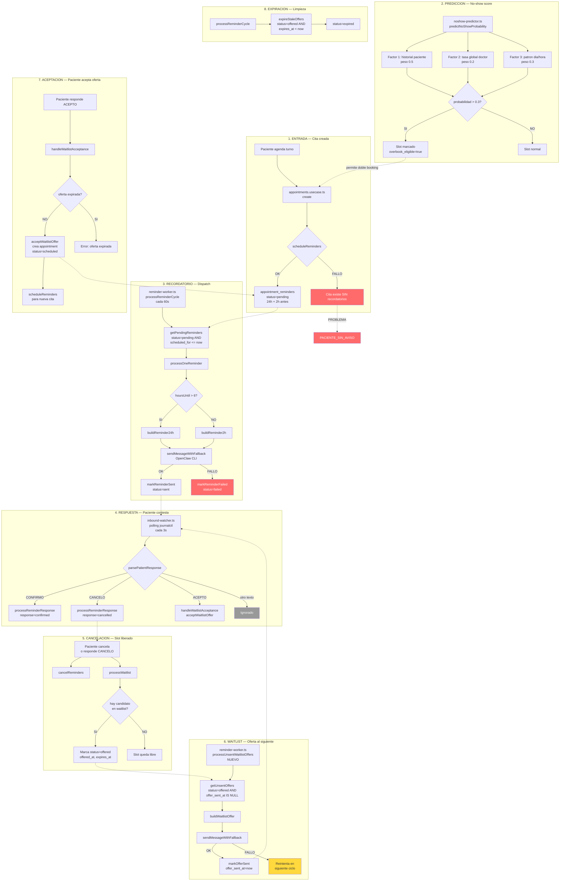

# Arquitectura Anti No-Show — AutaMedica

## Vista general del sistema



---

## Estado por componente

```
 ESTADO    COMPONENTE                          RIESGO    NOTAS
 -------- ----------------------------------- --------- ------------------------------------------
 [OK]      Recordatorio 24h                    Bajo      Funcional, templates correctos
 [OK]      Recordatorio 2h                     Bajo      Funcional, templates correctos
 [OK]      Confirmacion via WhatsApp            Bajo      CONFIRMO/CANCELO parseado correctamente
 [OK]      Cancelacion libera slot              Bajo      Trigger DB + processWaitlist
 [OK]      Waitlist matching por preferencias   Bajo      Filtra fecha/hora/prioridad
 [OK]      Expiracion de ofertas vencidas       Bajo      Corre cada 60s en worker + edge function
 [OK]      Overbooking inteligente             Bajo      Funcional con threshold 0.3
 [NUEVO]   Waitlist offer auto-dispatch         Bajo      Recien implementado, cierra el circuito
 -------- ----------------------------------- --------- ------------------------------------------
 [RIESGO]  Creacion de reminders               ALTO      Falla silenciosa, cita sin recordatorio
 [RIESGO]  Inbound watcher persistencia        ALTO      Mensaje perdido si backend esta caido
 [RIESGO]  Marcado de no-show                  ALTO      No hay endpoint que marque no_show
 [RIESGO]  Retry de reminders fallidos         MEDIO     status=failed es terminal, no reintenta
 [RIESGO]  Webhook sin rate limiting           MEDIO     Vulnerable a replay/flood
 [RIESGO]  Predictor parsing metadata          MEDIO     new_start_time puede ser malformado
 -------- ----------------------------------- --------- ------------------------------------------
 [MEJORA]  Config por doctor                   MEDIO     Hoy es global, no personalizable
 [MEJORA]  Blog dice 24h+1h, config dice 24h+2h BAJO    Inconsistencia comunicacion vs producto
 [MEJORA]  Blog dice "aprende", es heuristica  BAJO      Comunicacion inflada
 [MEJORA]  Cancelacion por doctor              BAJO      Solo paciente puede cancelar via usecase
```

---

## Puntos de falla detallados

### 1. CRITICO: Cita creada sin recordatorios

```
appointments.usecase.ts:79-86

    const appointment = await deps.appointmentsRepo.create(data)
    try {
      await scheduleReminders(deps.dbClient, appointment.id, 'whatsapp')
    } catch (reminderErr) {
      logger.error(...)  // <-- solo loguea, no re-throw
    }
    return appointment  // <-- cita existe, reminders no
```

**Impacto**: El paciente tiene cita pero nunca recibe recordatorio. Probabilidad alta de no-show.

**Solucion**: Envolver create + scheduleReminders en una transaccion DB. Si reminders falla, rollback de la cita. O como minimo: retry con backoff, o cola de "reminders pendientes de crear".

---

### 2. CRITICO: Nadie marca no_show

```
appointment_history trigger captura action='no_show' cuando
appointments.status cambia a 'no_show'.

PERO: No hay endpoint ni cron que setee status='no_show'.
```

**Impacto**: El predictor de no-show (`noshow-predictor.ts`) consulta `appointment_history` buscando `action='no_show'`. Si nunca se registra, el modelo siempre ve 0 no-shows y la probabilidad es siempre `BASE_RATE` (0.15). El overbooking inteligente nunca se activa porque ningun paciente supera el threshold de 0.3.

**Solucion**: Cron job o edge function que corra cada N minutos:

```sql
UPDATE appointments
SET status = 'no_show'
WHERE status IN ('scheduled', 'confirmed')
  AND start_time < now() - interval '30 minutes'
  AND end_time < now();
```

---

### 3. CRITICO: Inbound watcher pierde mensajes

```
inbound-watcher.ts:47-72

    const ok = await forwardToBackend(phone, text)
    if (!ok) {
      logger.error(...)  // <-- mensaje perdido para siempre
    }
```

**Impacto**: Si el backend esta caido cuando el paciente responde "CANCELO" o "ACEPTO", la respuesta se pierde. El paciente cree que cancelo, pero la cita sigue activa.

**Solucion**: Persistir mensajes inbound en tabla antes de forwardear:

```sql
CREATE TABLE inbound_messages (
  id uuid PRIMARY KEY,
  phone text NOT NULL,
  message text NOT NULL,
  processed boolean DEFAULT false,
  forwarded_at timestamptz,
  created_at timestamptz DEFAULT now()
);
```

---

### 4. MEDIO: Reminders fallidos no reintentan

```
reminder-worker.ts:69-75

    } catch (err) {
      result.failed++
      await markReminderFailed(supabase, reminder.id)  // terminal
    }
```

**Impacto**: Si OpenClaw tiene un timeout momentaneo, el reminder se marca como `failed` y nunca se reintenta. Paciente no recibe recordatorio.

**Solucion**: Agregar `retry_count` y `next_retry_at` a `appointment_reminders`. En vez de marcar `failed`, incrementar retry_count y setear next_retry_at con backoff exponencial. Solo marcar `failed` despues de 3 intentos.

---

### 5. MEDIO: Race condition en waitlist

```
waitlist.ts:84-94

    .update({ status: 'offered' })
    .eq('id', match.id)
    .eq('status', 'waiting')  // optimistic lock
```

El optimistic lock mitiga parcialmente, pero si dos workers corren simultaneamente:

- Worker A: busca candidatos, encuentra paciente X
- Worker B: busca candidatos, encuentra paciente X
- Worker A: UPDATE WHERE status='waiting' -> OK
- Worker B: UPDATE WHERE status='waiting' -> 0 rows (falla silenciosa)

**Impacto bajo** porque `processWaitlist` se llama sincricamente desde el request handler. Pero si se escala a multiples instancias del backend, puede haber duplicacion.

---

## Flujo completo: caso feliz vs caso de falla

### Caso feliz (funciona hoy)

```
Paciente agenda turno
  |
  v
Reminders creados (24h + 2h)
  |
  v
Worker envia reminder 24h antes por WhatsApp
  |
  v
Paciente responde "CONFIRMO"
  |
  v
Inbound watcher captura -> webhook -> processReminderResponse
  |
  v
Reminder marcado response=confirmed
  |
  v
Worker envia reminder 2h antes
  |
  v
Paciente asiste al turno
  |
  v
Doctor marca como completado  [*]
```

`[*]` No encontre endpoint de completado automatico tampoco.
Probablemente manual via UI del doctor.

### Caso: paciente cancela via WhatsApp

```
Paciente responde "CANCELO" al reminder
  |
  v
inbound-watcher -> webhook -> handleConfirmOrCancel
  |
  v
processReminderResponse(cancelled) + processWaitlist()
  |
  v
Waitlist: busca candidato que matchee fecha/hora
  |
  v
Candidato encontrado -> status=offered, offered_at=now, expires_at=+4h
  |
  v
[NUEVO] reminder-worker detecta offer_sent_at IS NULL
  |
  v
[NUEVO] buildWaitlistOffer -> sendMessageWithFallback -> WhatsApp
  |
  v
[NUEVO] markOfferSent(offer_sent_at=now)
  |
  v
Paciente en espera responde "ACEPTO"
  |
  v
inbound-watcher -> webhook -> handleWaitlistAcceptance
  |
  v
acceptWaitlistOffer -> crea nueva cita + scheduleReminders
  |
  v
Slot reasignado exitosamente
```

### Caso de falla: backend caido

```
Paciente responde "CANCELO"
  |
  v
inbound-watcher captura mensaje
  |
  v
forwardToBackend() -> HTTP 503 (backend caido)
  |
  v
logger.error(...)   <-- MENSAJE PERDIDO
  |
  v
Paciente cree que cancelo, pero cita sigue activa
  |
  v
No se procesa waitlist
  |
  v
Slot queda ocupado con paciente que no va a venir
  |
  v
NO-SHOW (sin registro porque nadie marca no_show)
```

### Caso de falla: reminders no creados

```
Paciente agenda turno
  |
  v
appointments.create() -> OK (cita en DB)
  |
  v
scheduleReminders() -> ERROR (ej: tabla bloqueada, timeout)
  |
  v
catch -> logger.error()   <-- NO re-throw
  |
  v
return appointment  <-- paciente recibe confirmacion
  |
  v
Worker no encuentra reminders para esta cita
  |
  v
Paciente nunca recibe WhatsApp
  |
  v
Probable NO-SHOW
```

---

## Mapa de archivos del sistema

```
packages/scheduling/src/
  |-- slots.ts              Generacion de slots + overbooking
  |-- noshow-predictor.ts   Prediccion heuristica de no-show
  |-- reminders.ts          CRUD de appointment_reminders
  |-- waitlist.ts           Gestion de lista de espera
  |-- openclaw.ts           Templates de mensajes + envio CLI
  |-- reminder-worker.ts    Ciclo principal del worker
  |-- index.ts              Re-exports publicos
  |
apps/reminder-worker/src/
  |-- index.ts              Entry point del worker (long-running)
  |-- inbound-watcher.ts    Polling de respuestas WhatsApp
  |
apps/web/src/
  |-- lib/patients/usecases/
  |     |-- appointments.usecase.ts   Create/cancel/update citas
  |
  |-- lib/webhooks/
  |     |-- services/openclaw.service.ts   Logica de negocio webhook
  |     |-- repos/openclaw.repo.ts         Queries DB para webhooks
  |
  |-- pages/api/webhooks/
  |     |-- openclaw.ts     Endpoint POST /api/webhooks/openclaw
  |
supabase/
  |-- migrations/
  |     |-- 20260318100000_mediagenda_foundation.sql   Tablas base
  |     |-- 20260413100000_waitlist_offer_sent_tracking.sql  NUEVO
  |
  |-- functions/
        |-- process-reminders/index.ts   Edge function (redundancia)
```

---

## Prioridades de mejora sugeridas

```
 PRI   PROBLEMA                                    ESFUERZO   IMPACTO
 ----- ------------------------------------------ ---------- ---------
 P0    Cron/trigger que marque no_show automatico   2h         CRITICO
       (sin esto, el predictor no tiene datos)
 P0    Persistir inbound messages antes de forward  3h         CRITICO
       (sin esto, se pierden respuestas)
 P1    Transaccion atomica create + reminders       2h         ALTO
 P1    Retry con backoff para reminders fallidos    3h         ALTO
 P2    Config por doctor (reminder timing)          4h         MEDIO
 P2    Rate limiting en webhook openclaw            1h         MEDIO
 P2    Validacion de metadata en predictor          1h         MEDIO
 P3    Alinear blog (24h+1h vs 24h+2h)             0.5h       BAJO
 P3    Cancelacion por doctor via usecase           2h         BAJO
```
