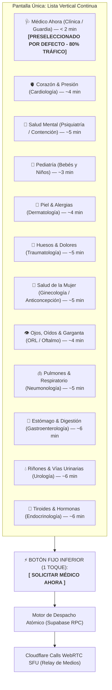
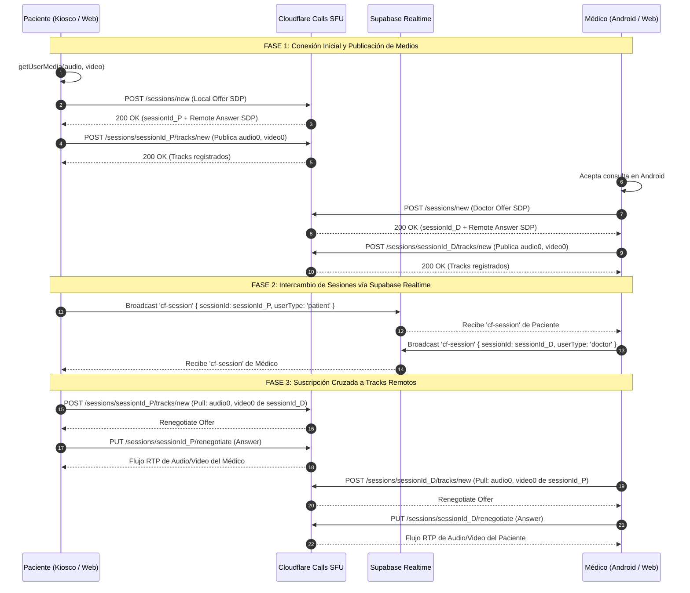
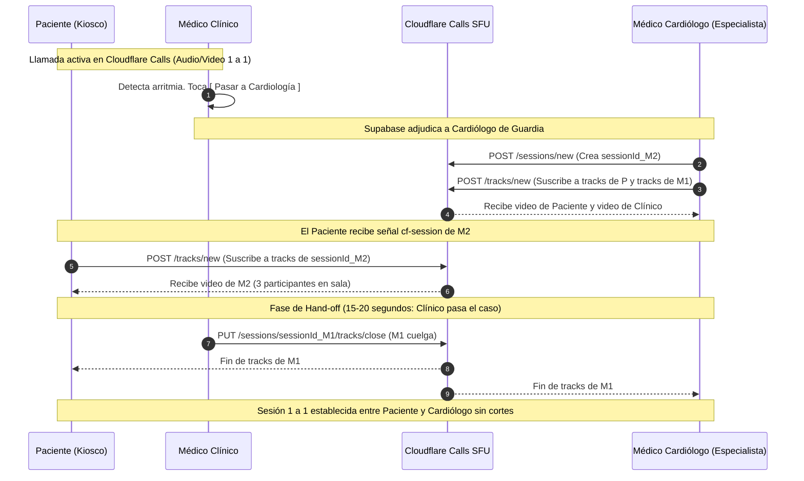
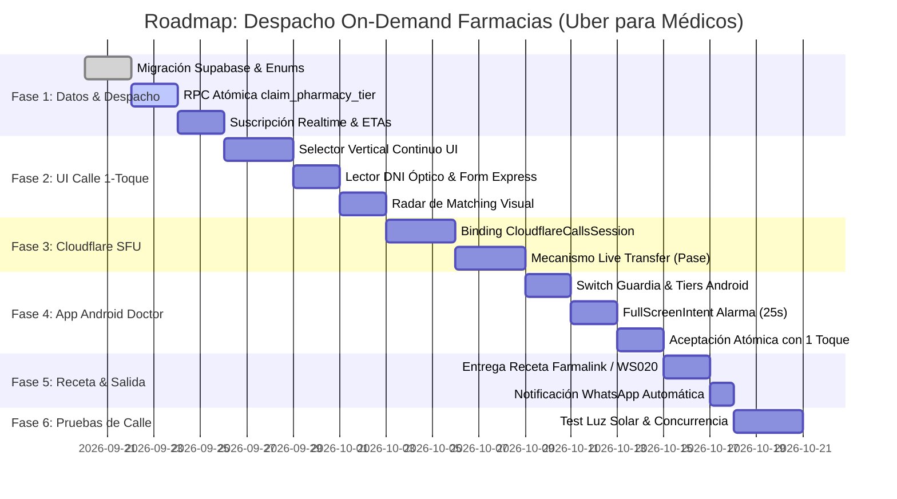

# Plan Maestro Técnico y de Producto: Ecosistema On-Demand de Atención Médica en Farmacias y Vía Pública ("Uber para Médicos")

> **Documento Canónico de Arquitectura, UX de Despacho y Especificación de Ingeniería.**  
> **Proyecto:** AutaMedica (Web Kiosco/Móvil Calle + Android Doctor + Backend Supabase Realtime + Cloudflare Calls SFU).  
> **Revisión de Arquitectura:** Eliminación total de capas anidadas en UI. Adopción de la **Psicología de la Calle** (Single-Scroll 1-Toque estilo Uber Ride Selector). Sustitución rigurosa del plano de medios por **Cloudflare Calls WebRTC SFU** (ADR-0003 canónico de AutaMedica).

---

## 1. Fundamentos Psicológicos y de Diseño: "La Realidad de la Calle y el Mostrador"

### A. La Psicología de la Calle vs. La Casa: Por qué el modelo de 3 capas fracasa en la vía pública
No es lo mismo utilizar una aplicación en el sillón de la casa que utilizarla parado en la calle o frente al mostrador de una farmacia:

| Factor de Uso | En la Casa (Entorno Controlado) | En la Calle / Puerta de Farmacia (Vía Pública) |
| :--- | :--- | :--- |
| **Iluminación** | Luz artificial o indirecta, contraste perfecto. | **Sol directo y reflejos:** Pérdida de más del 60% del contraste útil en pantalla. |
| **Ergonomía** | Ambas manos libres, cuerpo sentado y apoyado. | **Una sola mano:** La otra lleva bolsas, sostiene a un hijo o se agarra el pecho. |
| **Atención** | Silencio, calma, capacidad de leer y comparar. | **Ruido ensordecedor:** Bocinas, colectivos, transeúntes rozando al usuario. |
| **Estado Fisiológico** | Sin urgencia vital; tiempo para explorar. | **Dolor agudo, angustia o apuro:** Fiebre, cólico, presión en 160/100, llanto de un bebé. |
| **Procesamiento UI** | Tolera jerarquías, menús, pestañas y modales. | **Incapacidad total de descifrar 3 capas:** Si hay 3 capas, el usuario no sabe en cuál hacer click y falla. |

#### El Síndrome de la Confusión de Capas:
Cuando un sistema móvil o kiosco superpone 3 capas (ej. Fondo de contexto ➔ Catálogo de categorías ➔ Modal de detalle o confirmación), **una persona en la calle colapsa**:
1. El reflejo del sol borra la distinción visual entre las capas de fondo y las capas frontales.
2. La mente bajo dolor no decodifica profundidad espacial (*z-index*). No sabe si el botón que ve pertenece a la pantalla base o al modal emergente.
3. El intento de dar "click en la capa correcta" termina en toques en falso sobre el fondo oscuro, cierre accidental de modales y abandono inmediato.

### B. Por qué Uber Realmente Funciona en la Calle
Uber es el caso de éxito universal en la calle precisamente por cómo resuelve este dilema:
- **Estructuralmente, Uber tiene 3 capas:**
  1. *Capa 1 (Mundo Real / Contexto):* El mapa con la geolocalización y los autos circulando.
  2. *Capa 2 (Niveles de Flota):* La lista de opciones (`UberX`, `Comfort`, `Black`, `Moto`) con tarifas y tiempos.
  3. *Capa 3 (Acción y Compromiso):* El método de pago, el estado del despacho y el botón de confirmación.
- **Pero para el usuario en la calle, solo existe UNA ÚNICA CAPA QUE LE INTERESA:**
  - El usuario no tiene que interpretar las 3 capas ni buscar en cuál hacer click.
  - El mapa (Capa 1) es pasivo: solo da tranquilidad visual.
  - La lista (Capa 2) tiene el 80% de la demanda resuelto de fábrica: **`UberX` ya viene preseleccionado por defecto**.
  - La atención y el pulgar van directos a la **única capa que le interesa: el botón gigante inferior [ CONFIRMAR UBERX ]**.
  - Si el usuario necesita otra opción (ej. un auto más grande), simplemente desliza el pulgar hacia arriba en esa misma lista continua, toca la tarjeta con 1 solo toque y confirma. **Cero modales, cero navegación entre capas.**

### C. Principio Rector de AutaMedica: La Única Capa que le Interesa al Paciente
AutaMedica traslada con rigor matemático esta misma regla a la atención médica de demanda espontánea:
- **Colapso a una sola capa focal interactiva:** Cero modales superpuestos, cero ventanas emergentes de confirmación que tapen el fondo, cero jerarquías de 3 niveles.
- **Preselección universal del 80%:** La opción dominante (`🩺 Médico Ahora - Guardia / Clínica`) viene **activa por defecto**. Resuelve fiebre, recetas vencidas, certificados, dolor de garganta o malestar general sin tocar nada más.
- **Ancla visual inconfundible:** Un botón gigante inferior permanente (**Sticky Bottom Action Bar**) con contraste extremo:  
  **`[ ⚡ SOLICITAR MÉDICO AHORA (< 2 MIN) ]`**.
- **Cambio en 1 toque sin salir de la capa:** Si el paciente busca una especialidad concreta, los iconos y síntomas viven en la misma secuencia vertical continua:
  - Dolor torácico o presión alta ➔ **`🫀 Corazón & Presión`** (1 toque).
  - Fiebre infantil ➔ **`👶 Pediatría`** (1 toque).
  - Pánico o angustia ➔ **`🧠 Salud Mental`** (1 toque).
  - Erupción cutánea ➔ **`🧴 Piel & Alergias`** (1 toque).
- Al tocar una especialidad, el botón inferior se actualiza de inmediato (`[ ⚡ SOLICITAR CARDIÓLOGO AHORA (~4 MIN) ]`). **El usuario siempre sabe dónde está la única capa que le interesa.**

---

## 2. El Catálogo Vertical Unificado (Uber Ride Selector Médico)

Toda la oferta médica vive en una única secuencia vertical, ordenada por frecuencia estadística de demanda en farmacias y vía pública:



### Especificación de las Filas de la Lista (Cards de 1 Toque):

| Tier / Especialidad | Icono | Identificador Clínico Visible | SLA / ETA Dinámico | Acción por Defecto |
| :--- | :---: | :--- | :---: | :--- |
| **Médico Ahora (General / Guardia)** | 🩺 | Fiebre, gripe, recetas, certificados, triaje | **< 2 min** | **Activo por defecto** |
| **Corazón & Presión** | 🫀 | Palpitaciones, tensión alta, dolor torácico | **~4 min** | 1 toque cambia selección |
| **Salud Mental & Apoyo** | 🧠 | Ataques de pánico, angustia, insomnio, recetas | **~5 min** | 1 toque cambia selección |
| **Pediatría Inmediata** | 👶 | Fiebre infantil, pautas de alarma, erupciones | **~3 min** | 1 toque cambia selección |
| **Piel & Alergias** | 🧴 | Erupciones súbitas, picaduras, quemaduras | **~4 min** | 1 toque cambia selección |
| **Huesos & Dolores** | 🦴 | Torceduras, lumbalgia, contracturas agudas | **~5 min** | 1 toque cambia selección |
| **Salud de la Mujer** | 🌸 | Anticoncepción de emergencia, cistitis, cólicos | **~5 min** | 1 toque cambia selección |
| **Ojos, Oídos & Garganta** | 👁️ | Conjuntivitis, dolor de oído punzante, faringitis | **~4 min** | 1 toque cambia selección |
| **Pulmones & Respiratorio** | 🫁 | Asma, broncoespasmo, tos persistente | **~5 min** | 1 toque cambia selección |
| **Estómago & Digestión** | 🫄 | Acidez severa, gastroenteritis, dolor abdominal | **~6 min** | 1 toque cambia selección |
| **Riñones & Vías Urinarias** | 💧 | Infección urinaria masculina/femenina, cólico | **~6 min** | 1 toque cambia selección |
| **Tiroides & Hormonas** | 🦋 | Ajuste de levotiroxina, dudas metabólicas | **~6 min** | 1 toque cambia selección |

> **Regla de Vacancia Cero (Graceful Routing):** Si el usuario toca una subespecialidad (ej. *Tiroides & Hormonas*) y en ese momento exacto no hay endocrinólogos libres, el sistema jamás muestra una pantalla de error ni bloquea la acción. En el mismo diálogo de confirmación le informa con transparencia:  
> *"Endocrinólogos en consulta. Un Médico Clínico de Guardia puede atenderte en < 1 min, evaluar tus análisis, renovarte la receta y transferirte en caliente si hace falta."*

---

## 3. Flujo Completo del Paciente (The Rider App — Web Kiosco / Celular en Vía Pública)

### Pantalla 1: Selector Vertical Continuo (The Uber Ride List)
Diseño adaptado a pantallas táctiles de kioscos y teléfonos bajo luz solar. Alto contraste (Fondo Deep Navy `#0B132B`, texto Blanco `#FFFFFF`, acentos Cian `#00EBFF` y Esmeralda `#10B981` para estados en línea). **Prohibido el uso de amarillo**.

```text
┌────────────────────────────────────────────────────────────────────────┐
│ ➕ AUTAMEDICA ON-DEMAND                   📍 Farmacia Casey  🕒 10:45 AM│
│                                                                        │
│ ¿Qué atención médica necesitas hoy?                                    │
│                                                                        │
│ ┌────────────────────────────────────────────────────────────────────┐ │
│ │ (•) 🩺 Médico Ahora (Clínica / Guardia)             ⚡ < 2 min    │ │
│ │     Fiebre, malestar, renovación de recetas y triaje 🟢 7 libres  │ │
│ └────────────────────────────────────────────────────────────────────┘ │
│ ┌────────────────────────────────────────────────────────────────────┐ │
│ │ ( ) 🫀 Corazón & Presión (Cardiología)              ⚡ ~4 min    │ │
│ │     Tensión alta, palpitaciones, opresión torácica  🟢 2 libres  │ │
│ └────────────────────────────────────────────────────────────────────┘ │
│ ┌────────────────────────────────────────────────────────────────────┐ │
│ │ ( ) 🧠 Salud Mental (Psiquiatría / Apoyo)           ⚡ ~5 min    │ │
│ │     Crisis de pánico, angustia, insomnio agudo      🟢 3 libres  │ │
│ └────────────────────────────────────────────────────────────────────┘ │
│ ┌────────────────────────────────────────────────────────────────────┐ │
│ │ ( ) 👶 Pediatría (Bebés y Niños)                    ⚡ ~3 min    │ │
│ │     Fiebre en lactantes, pautas de alarma, mocos    🟢 2 libres  │ │
│ └────────────────────────────────────────────────────────────────────┘ │
│ ┌────────────────────────────────────────────────────────────────────┐ │
│ │ ( ) 🧴 Piel & Alergias (Dermatología)               ⚡ ~4 min    │ │
│ │     Erupciones súbitas, picaduras, quemaduras       🟢 2 libres  │ │
│ └────────────────────────────────────────────────────────────────────┘ │
│ ┌────────────────────────────────────────────────────────────────────┐ │
│ │ ( ) 🦴 Huesos & Dolores (Traumatología)             ⚡ ~5 min    │ │
│ │     Torceduras de tobillo, lumbago, dolor articular 🟢 1 libre   │ │
│ └────────────────────────────────────────────────────────────────────┘ │
│ ┌────────────────────────────────────────────────────────────────────┐ │
│ │ ( ) 🌸 Salud de la Mujer (Ginecología)              ⚡ ~5 min    │ │
│ │     Anticoncepción de emergencia, cistitis, cólicos 🟢 2 libres  │ │
│ └────────────────────────────────────────────────────────────────────┘ │
│                                                                        │
│ ══════════════════════════════════════════════════════════════════════ │
│ ┌────────────────────────────────────────────────────────────────────┐ │
│ │          ⚡ [ SOLICITAR MÉDICO AHORA (ESPERA < 2 MIN) ]            │ │
│ └────────────────────────────────────────────────────────────────────┘ │
└────────────────────────────────────────────────────────────────────────┘
```

### Pantalla 2: Identificación de 1 Paso (10 Segundos)
Solo se solicitan los dos datos indispensables para:
1. Validar la identidad del paciente ante el sistema de salud.
2. Emitir la receta electrónica homologada (Ley 27.553, Decreto 63/2024, Farmalink, SISA WS020).
3. Entregar la receta en su WhatsApp al finalizar.

```text
┌────────────────────────────────────────────────────────────────────────┐
│ ← Cambiar atención                             Especialidad: MÉDICO AHORA│
│                                                                        │
│ Completá tus datos para conectar con el médico de guardia:             │
│                                                                        │
│ ┌────────────────────────────────────────────────────────────────────┐ │
│ │ 📷 KIOSCO: APOYÁ TU DNI FRENTE AL ESCÁNER ÓPTICO (Lectura 300 ms)  │ │
│ └────────────────────────────────────────────────────────────────────┘ │
│ ───────────────────── O escribí con teclado numérico ─────────────────── │
│                                                                        │
│ Número de Documento (DNI / Pasaporte):                                 │
│ ┌────────────────────────────────────────────────────────────────────┐ │
│ │ 34.892.110                                                         │ │
│ └────────────────────────────────────────────────────────────────────┘ │
│                                                                        │
│ Teléfono Móvil (Aquí recibirás tu receta por WhatsApp al terminar):    │
│ ┌────────────────────────────────────────────────────────────────────┐ │
│ │ +54 9 11 3200-8844                                                 │ │
│ └────────────────────────────────────────────────────────────────────┘ │
│                                                                        │
│ ┌────────────────────────────────────────────────────────────────────┐ │
│ │                🚀 [ CONECTAR CON MÉDICO YA MISMO ]                 │ │
│ └────────────────────────────────────────────────────────────────────┘ │
└────────────────────────────────────────────────────────────────────────┘
```

### Pantalla 3: Radar de Despacho (Matching en Tiempo Real)
Visualización inspirada en el radar de despacho de Uber. Círculos concéntricos pulsantes con animación CSS fluida. Tiempo medio de matching: **8 a 15 segundos**.

```text
┌────────────────────────────────────────────────────────────────────────┐
│                                                                        │
│                                  ◎                                     │
│                             ◎   🩺   ◎                                 │
│                                  ◎                                     │
│                                                                        │
│                     Buscando médico de guardia libre...                │
│                         Notificando a profesionales                    │
│                                                                        │
│ ───────────────────── ¡MÉDICO ASIGNADO (< 10 seg)! ─────────────────── │
│                                                                        │
│                     ┌────────────────────────────────┐                 │
│                     │  Dr. Facundo Morales           │                 │
│                     │  Médico Clínico Universitario  │                 │
│                     │  M.N. 158.420 / M.P. 54.120    │                 │
│                     └────────────────────────────────┘                 │
│                                                                        │
│                     Abriendo sala de videoconsulta...                  │
└────────────────────────────────────────────────────────────────────────┘
```

### Pantalla 4: Videoconsulta Full-Bleed Cloudflare Calls SFU y Entrega de Receta
- **Fondo Full-Bleed:** El video del médico cubre el 100% de la pantalla para generar contacto visual humano y directo. Cero modales web centrados que tapen la imagen.
- **HUD Periférico (Inferior):** Botón para silenciar micrófono, botón de finalizar consulta, y switch de cámara (en celular para mostrar una lesión en la piel o garganta).
- **Post-Consulta Inmediato:** Al finalizar la llamada, la pantalla muestra el comprobante y el paciente recibe en menos de 5 segundos el PDF con código de barras Farmalink en su WhatsApp. Si está en el kiosco de la farmacia, el mostrador ya tiene la orden lista para dispensar.

---

## 4. Arquitectura de Medios: Cloudflare Calls WebRTC SFU (ADR-0003 Canónico)

> **Regla de Oro:** AutaMedica **NO utiliza LiveKit**. El plano de medios unificado canónico tanto para Web como para Android es **Cloudflare Calls WebRTC SFU**, implementado en `packages/telemedicine/src/cloudflare-calls/`.

### A. Topología y Componentes de Cloudflare Calls
Cloudflare Calls opera como un **Selective Forwarding Unit (SFU) Anycast distribuido globalmente**:
1. **Cliente WebRTC:** Cada participante (Kiosco/Paciente o Médico Android) levanta un único `RTCPeerConnection` contra el Edge de Cloudflare más cercano.
2. **Full ICE:** Cloudflare incluye todos sus candidatos ICE directamente en la respuesta SDP. No se utiliza trickle ICE lento en redes móviles con latencia.
3. **Control de Sesión:** Las llamadas REST se ejecutan a través de endpoints proxy autorizados (`/api/calls/cloudflare-calls`), evitando exponer credenciales de Cloudflare Calls en el cliente:
   - `POST /sessions/new`: Registra la oferta SDP del cliente y retorna un `sessionId` y la `sessionDescription` (Answer) de Cloudflare.
   - `POST /sessions/{sessionId}/tracks/new`: Registra los tracks locales publicados (`audio0`, `video0`) o suscribe a tracks remotos provenientes de otra sesión.
   - `PUT /sessions/{sessionId}/renegotiate`: Responde a renegociaciones iniciadas por Cloudflare cuando se agregan o quitan tracks remotos.
   - `PUT /sessions/{sessionId}/tracks/close`: Cierra explícitamente los tracks para evitar "dead tracks" cuando un participante abandona.
4. **Señalización:** Se realiza mediante **Supabase Realtime** en el canal `signaling:{roomId}` intercambiando mensajes JSON con el payload `{ type: 'cf-session', data: { sessionId, userType } }`.



---

### B. El Mecanismo de Transferencia en Vivo ("Pasar a Colega" / Live Transfer) en Cloudflare Calls
Una de las mayores ventajas de Cloudflare Calls SFU sobre mallas P2P o sistemas tradicionales es la **transferencia en caliente multipunto sin costo computacional para el paciente**:

#### Escenario Clínico:
El paciente ingresa por *Médico Ahora (Guardia General)*. El Dr. Facundo Morales (Clínico) detecta que el paciente tiene una arritmia o una crisis hipertensiva que requiere evaluación por Cardiólogo.

#### Procedimiento Técnico en 5 Pasos:
1. **Disparo de Interconsulta:** El Dr. Morales presiona en su app el botón `[ 🔀 Pasar a Colega ]` y selecciona `Cardiología`.
2. **Despacho del Especialista:** El motor de despacho en Supabase adjudica la solicitud de interconsulta con máxima prioridad al Dr. Rossi (Cardiólogo en Android).
3. **Ingreso del Cardiólogo a Cloudflare Calls:**
   - El Dr. Rossi inicializa su `CloudflareCallsSession` y crea `sessionId_Cardio`.
   - Publica sus propios tracks locales (`audio0`, `video0`).
   - El Dr. Rossi se suscribe en Cloudflare a los tracks del Paciente (`sessionId_P`) Y a los tracks del Dr. Morales (`sessionId_Clínico`).
4. **Suscripción Automática del Paciente:**
   - El cliente del paciente recibe vía Supabase Realtime el mensaje `cf-session` con `sessionId_Cardio`.
   - Llama a `subscribeToSession(sessionId_Cardio)` en su `CloudflareCallsSession`.
   - **El paciente no corta ni reinicia nada.** Simplemente ve aparecer una segunda ventana de video con el Cardiólogo.
5. **Pase Mano a Mano (Hand-off Médico) y Salida Limpia:**
   - Durante 20 segundos, los tres participantes conversan:  
     *Dr. Morales (Clínico): "Alejandro, te presento a Eduardo, vino con 150/95 y palpitaciones. Ya le revisé la medicación previa, te lo dejo en tus manos".*  
     *Dr. Rossi (Cardiólogo): "Perfecto Facundo, gracias, continúo yo".*
   - El Dr. Morales presiona `[ Salir de la Llamada ]`.
   - Su cliente ejecuta `tracks/close` en Cloudflare Calls y destruye su sesión.
   - El SFU deja de rutear los tracks de Morales.
   - El Paciente y el Cardiólogo quedan en conexión 1-a-1 fluida, sin interrupción de audio y sin haber tocado la pantalla.



---

## 5. Flujo del Médico (The Driver App — Android Kotlin & Web)

El profesional de la salud opera con la misma agilidad que un conductor de plataforma de movilidad, sin agendas burocráticas ni formularios pesados.

### A. Switch de Estado y Selección de Tiers Activos
En su pantalla de inicio (`DoctorDashboardScreen`), el médico tiene un switch permanente:
- **`[ 🟢 EN SERVICIO ]`** / **`[ 🔴 FUERA DE SERVICIO ]`**.
- Al activarlo, puede marcar con qué tiers prestará guardia:
  - `[X] Mi Especialidad (ej. ❤️ Cardiología)`
  - `[X] Apoyo a Guardia General (🩺 Médico Ahora)` ➔ Permite que cardiólogos, pediatras y traumatólogos tomen consultas de demanda espontánea cuando su cola de especialidad esté tranquila, maximizando sus ingresos por guardia.

```text
┌────────────────────────────────────────────────────────────────────────┐
│ Dr. Alejandro Rossi                                  [ 🟢 EN SERVICIO ] │
│ Especialidad: Cardiología / Medicina Interna                           │
│ ────────────────────────────────────────────────────────────────────── │
│ TIERS ACTIVOS PARA DESPACHO EN ESTA GUARDIA:                           │
│ [X] ❤️ Cardiología (Mi Especialidad)                                   │
│ [X] 🩺 Médico Ahora (Guardia General de Demanda Espontánea)            │
│                                                                        │
│ ESTADÍSTICAS DEL TURNO:                                                │
│ • Consultas atendidas: 8               • Tiempo promedio: 7 min 40 seg │
│ • Honorarios generados: $ 52.000       • Calificación: 4.98 ⭐          │
└────────────────────────────────────────────────────────────────────────┘
```

---

### B. Notificación de Despacho Entrante en Android (Countdown de 25s)
Para que el médico no pierda llamadas aunque tenga el teléfono en el bolsillo o esté usando otra aplicación:
1. **`NotificationFullScreenIntent`:** Salta automáticamente en Android, encendiendo la pantalla y sobreponiéndose a cualquier app en primer plano.
2. **Audio Persistente de Prioridad Máxima:** Utiliza `AudioAttributes.USAGE_ALARM` o `USAGE_NOTIFICATION_RINGTONE` con bypass del modo "No molestar" para emergencias médicas.
3. **Temporizador Regresivo de 25 Segundos:** Si el médico no contesta en 25 segundos, la solicitud salta de inmediato al siguiente colega disponible en el pool sin penalizaciones ni bloqueos burocráticos.
4. **Botón Gigante de 1 Toque:**

```text
┌────────────────────────────────────────────────────────────────────────┐
│                                                                        │
│                 🔔 NUEVA CONSULTA ENTRANTE EN FARMACIA                 │
│                                                                        │
│ Tipo:             🩺 MÉDICO AHORA (Demanda Espontánea)                 │
│ Ubicación:        📍 Farmacia Carlos Casey - Kiosco 1                  │
│ Paciente:         Eduardo M. (52 años) - DNI 34.892.110                │
│ Motivo declarado: "Pico de presión 150/95 y renovación Losartán"       │
│                                                                        │
│                         Tiempo para aceptar:                           │
│                                ┌──────┐                                │
│                                │ 21 s │                                │
│                                └──────┘                                │
│                                                                        │
│ ┌────────────────────────────────────────────────────────────────────┐ │
│ │               [ ✅ ACEPTAR CONSULTA AHORA (1 TOQUE) ]              │ │
│ └────────────────────────────────────────────────────────────────────┘ │
│                                                                        │
│                      [ Pasar a colega (Rechazar) ]                     │
└────────────────────────────────────────────────────────────────────────┘
```

Al presionar **`[ ✅ ACEPTAR CONSULTA AHORA ]`**, el cliente Android ejecuta la RPC `public.claim_pharmacy_request_tier`. Si gana el reclamo atómico, la app inicializa `CloudflareCallsSession.kt` y entra a la llamada en **menos de 600 milisegundos**.

---

## 6. Modelo de Datos y Motor de Despacho Atómico (Supabase PostgreSQL)

### A. Migración SQL Idempotente (`supabase/migrations/`)

```sql
-- 1. Categorías de Tiers compatibles con la UX de 1 Toque
DO $$ BEGIN
    CREATE TYPE public.dispatch_tier_category AS ENUM (
        'general',
        'cardiologia',
        'salud_mental',
        'pediatria',
        'dermatologia',
        'traumatologia',
        'salud_femenina',
        'oftalmo_otorrino',
        'neumonologia',
        'gastroenterologia',
        'urologia',
        'endocrinologia'
    );
EXCEPTION
    WHEN duplicate_object THEN null;
END $$;

DO $$ BEGIN
    CREATE TYPE public.dispatch_request_status AS ENUM (
        'searching',
        'matched',
        'in_call',
        'transferring',
        'transferred',
        'completed',
        'cancelled',
        'expired'
    );
EXCEPTION
    WHEN duplicate_object THEN null;
END $$;

-- 2. Kioscos Físicos y Puntos de Despacho
CREATE TABLE IF NOT EXISTS public.pharmacy_kiosks (
    id UUID PRIMARY KEY DEFAULT gen_random_uuid(),
    pharmacy_id UUID NOT NULL REFERENCES public.pharmacies(id) ON DELETE CASCADE,
    device_fingerprint TEXT UNIQUE NOT NULL,
    friendly_name TEXT NOT NULL,
    hardware_type TEXT NOT NULL DEFAULT 'kiosk_touch', -- 'kiosk_touch', 'street_mobile', 'counter_tablet'
    active BOOLEAN NOT NULL DEFAULT true,
    last_ping_at TIMESTAMPTZ NOT NULL DEFAULT NOW(),
    created_at TIMESTAMPTZ NOT NULL DEFAULT NOW()
);

-- 3. Estado de Guardia del Médico
CREATE TABLE IF NOT EXISTS public.doctor_duty_status (
    doctor_id UUID PRIMARY KEY REFERENCES public.doctors(id) ON DELETE CASCADE,
    is_on_duty BOOLEAN NOT NULL DEFAULT false,
    active_tiers public.dispatch_tier_category[] NOT NULL DEFAULT '{general}'::public.dispatch_tier_category[],
    current_active_request_id UUID,
    duty_started_at TIMESTAMPTZ,
    last_heartbeat_at TIMESTAMPTZ NOT NULL DEFAULT NOW(),
    updated_at TIMESTAMPTZ NOT NULL DEFAULT NOW()
);

-- 4. Solicitudes de Despacho On-Demand (Cloudflare Calls SFU)
CREATE TABLE IF NOT EXISTS public.pharmacy_dispatch_requests (
    id UUID PRIMARY KEY DEFAULT gen_random_uuid(),
    kiosk_id UUID REFERENCES public.pharmacy_kiosks(id),
    pharmacy_id UUID REFERENCES public.pharmacies(id),
    patient_dni TEXT NOT NULL,
    patient_phone TEXT NOT NULL,
    patient_name TEXT,
    tier_requested public.dispatch_tier_category NOT NULL,
    symptom_summary TEXT,
    
    -- Estado y Asignación
    status public.dispatch_request_status NOT NULL DEFAULT 'searching',
    assigned_doctor_id UUID REFERENCES public.doctors(id),
    previous_doctor_id UUID REFERENCES public.doctors(id), -- En caso de transferencia
    
    -- Sesión Cloudflare Calls y Sala
    cloudflare_room_id TEXT UNIQUE NOT NULL,
    patient_cf_session_id TEXT,
    doctor_cf_session_id TEXT,
    
    -- SLAs y Auditoría Temporal
    created_at TIMESTAMPTZ NOT NULL DEFAULT NOW(),
    matched_at TIMESTAMPTZ,
    call_started_at TIMESTAMPTZ,
    call_ended_at TIMESTAMPTZ,
    search_timeout_at TIMESTAMPTZ NOT NULL DEFAULT (NOW() + INTERVAL '25 seconds')
);

-- 5. Índices para Alto Rendimiento (< 2 ms en queries concurrentes)
CREATE INDEX IF NOT EXISTS idx_dispatch_searching_queue
    ON public.pharmacy_dispatch_requests (tier_requested, status, created_at)
    WHERE status = 'searching';

CREATE INDEX IF NOT EXISTS idx_doctor_duty_active_lookup
    ON public.doctor_duty_status (is_on_duty, last_heartbeat_at)
    WHERE is_on_duty = true;

-- Habilitar RLS y Supabase Realtime
ALTER TABLE public.pharmacy_dispatch_requests ENABLE ROW LEVEL SECURITY;
ALTER TABLE public.doctor_duty_status ENABLE ROW LEVEL SECURITY;

ALTER PUBLICATION supabase_realtime ADD TABLE public.pharmacy_dispatch_requests;
ALTER PUBLICATION supabase_realtime ADD TABLE public.doctor_duty_status;
```

---

### B. RPC PostgreSQL Atómica: `public.claim_pharmacy_request_tier`

```sql
CREATE OR REPLACE FUNCTION public.claim_pharmacy_request_tier(
    p_request_id UUID,
    p_doctor_id UUID
)
RETURNS JSONB
LANGUAGE plpgsql
SECURITY DEFINER
SET search_path = public, pg_temp
AS $$
DECLARE
    v_req RECORD;
    v_duty RECORD;
BEGIN
    -- 1. Validar que el médico esté en servicio activo
    SELECT * INTO v_duty
    FROM public.doctor_duty_status
    WHERE doctor_id = p_doctor_id AND is_on_duty = true
    FOR UPDATE;

    IF NOT FOUND THEN
        RETURN jsonb_build_object(
            'success', false,
            'code', 'DOCTOR_NOT_ON_DUTY',
            'message', 'Debes activar tu estado En Servicio para tomar consultas.'
        );
    END IF;

    -- 2. Bloquear la solicitud con SKIP LOCKED (cero colisiones si 10 médicos presionan Aceptar a la vez)
    SELECT * INTO v_req
    FROM public.pharmacy_dispatch_requests
    WHERE id = p_request_id AND status = 'searching'
    FOR UPDATE SKIP LOCKED;

    IF NOT FOUND THEN
        RETURN jsonb_build_object(
            'success', false,
            'code', 'REQUEST_ALREADY_CLAIMED_OR_EXPIRED',
            'message', 'La consulta ya fue asignada a otro colega o expiró su tiempo de espera.'
        );
    END IF;

    -- 3. Adjudicar la consulta al médico ganador
    UPDATE public.pharmacy_dispatch_requests
    SET assigned_doctor_id = p_doctor_id,
        status = 'matched',
        matched_at = NOW()
    WHERE id = p_request_id;

    -- 4. Actualizar el estado del médico para no enviarle nuevas llamadas mientras atiende
    UPDATE public.doctor_duty_status
    SET current_active_request_id = p_request_id,
        updated_at = NOW()
    WHERE doctor_id = p_doctor_id;

    RETURN jsonb_build_object(
        'success', true,
        'code', 'MATCH_SUCCESSFUL',
        'request_id', v_req.id,
        'cloudflare_room_id', v_req.cloudflare_room_id,
        'patient_dni', v_req.patient_dni,
        'patient_phone', v_req.patient_phone,
        'tier_requested', v_req.tier_requested
    );
END;
$$;
```

---

### C. Algoritmo de Cálculo Dinámico de ETA en Tiempo Real
El tiempo de espera mostrado en cada tarjeta no es una promesa vacía ni un valor estático:

$$ETA_{\text{Tier}} = \begin{cases} 
\text{< 2 min} & \text{si } N_{\text{médicos libres}} \ge 1 \\
\max\left(3.0, \frac{\sum T_{\text{remanente}} + (Q_{\text{cola}} \times 8)}{N_{\text{médicos en guardia}}}\right) & \text{si } N_{\text{libres}} = 0 \text{ y } N_{\text{guardia}} > 0 \\
\text{Fallback a Guardia General (< 1 min)} & \text{si } N_{\text{guardia}} = 0 
\end{cases}$$

Implementación estricta TypeScript en `pharmacy-on-demand.service.ts`:

```typescript
export interface TierEtaInfo {
  tier: DispatchTierCategory;
  doctorsOnline: number;
  doctorsFree: number;
  estimatedWaitMinutes: number;
  displayWaitText: string;
  isAvailable: boolean;
}

export function computeTierWaitTime(
  doctorsFree: number,
  doctorsOnDuty: number,
  queuedRequests: number,
  avgConsultMinutes: number = 8
): { minutes: number; text: string } {
  if (doctorsFree > 0) {
    return { minutes: 1.5, text: '< 2 min' };
  }
  if (doctorsOnDuty > 0) {
    const wait = Math.ceil(((queuedRequests + 1) * avgConsultMinutes) / doctorsOnDuty);
    const clamped = Math.max(3, wait);
    return { minutes: clamped, text: `~${clamped} min` };
  }
  return { minutes: 0, text: 'Derivación inmediata (< 1 min)' };
}
```

---

## 7. Módulos y Archivos del Repositorio a Modificar

| Capa / Módulo | Archivo Objetivo | Responsabilidad y Cambios Exactos |
| :--- | :--- | :--- |
| **Web Kiosco / Calle (UI)** | `apps/web/src/components/pharmacy/PharmacyExpressConsultation.tsx` | UI Single-Scroll continua de 1 Toque (Uber Ride Selector), selector de tarjetas grandes de 76px, radar visual de despacho y sala Cloudflare Calls Full-Bleed. |
| **Web Kiosco (Service)** | `apps/web/src/lib/pharmacy/pharmacy-on-demand.service.ts` | Servicio TypeScript de despacho: polling/Realtime de médicos en servicio, cálculo de ETA por tier, creación de request y binding con Cloudflare Calls. |
| **Página Kiosco (Astro)** | `apps/web/src/pages/pharmacy/express.astro` | Página web ultra-optimizada para Kioscos táctiles y móviles de calle. Layout Full-Bleed sin navbar ni distracciones. |
| **API Backend (Request)** | `apps/web/src/pages/api/pharmacy/dispatch/request.ts` | Endpoint POST para solicitar médico, reservar sala Cloudflare Calls e iniciar broadcast en Supabase Realtime. |
| **API Backend (Claim)** | `apps/web/src/pages/api/pharmacy/dispatch/claim.ts` | Invoca la RPC atómica `public.claim_pharmacy_request_tier` con auth JWT del médico. |
| **API Backend (Transfer)** | `apps/web/src/pages/api/pharmacy/dispatch/transfer.ts` | Orquesta la transferencia en caliente a especialista en Cloudflare Calls sin corte de llamada. |
| **Android Doctor (Card)** | `DoctorPharmacyOnDutyCard.kt` | Tarjeta en `DoctorDashboardScreen.kt` con switch "En Servicio" y chips de tiers activos. |
| **Android Doctor (Dialog)** | `PharmacyOnDemandIncomingCallDialog.kt` | Pantalla de llamada entrante con `FullScreenIntent`, audio persistente médico y cuenta regresiva de 25s. |
| **Android Doctor (Engine)** | `CloudflareCallsSession.kt` | Port canónico de `session.ts` a Kotlin para WebRTC SFU directo en Android (ADR-0003). |
| **Telemedicina Shared** | `packages/telemedicine/src/cloudflare-calls/transfer.ts` | Gestor de transferencia en caliente (Live Transfer) para agregar al colega a los tracks del SFU y desconectar al clínico de forma transparente. |

---

## 8. Roadmap de Ejecución por Fases (Entregables Concretos)



### Detalle de Fases de Ingeniería:
1. **Fase 1: Persistencia y Motor de Concurrencia en Supabase**
   - Ejecución de migraciones SQL idempotentes.
   - Creación de la RPC `public.claim_pharmacy_request_tier` con bloqueo optimista `FOR UPDATE SKIP LOCKED`.
   - Pruebas de estrés de concurrencia: 20 médicos aceptando la misma consulta al mismo milisegundo (verificar exactamente 1 ganador y 19 respuestas limpias).
2. **Fase 2: Interfaz de Calle / Kiosco de 1 Toque (The Rider App)**
   - Desarrollo de `PharmacyExpressConsultation.tsx` con la lista vertical unificada estilo Uber Ride Selector.
   - Alto contraste visual, targets táctiles > 76px, preselección automática de *Médico Ahora*.
   - Integración con el escáner óptico de código de barras PDF417 de DNI (300 ms).
3. **Fase 3: Integración con Cloudflare Calls SFU y Live Transfer**
   - Conexión del cliente Web y Kiosco contra `packages/telemedicine/src/cloudflare-calls/client.ts`.
   - Implementación del gestor de transferencia en caliente (`transfer.ts`): suscripción cruzada de tracks sin cortar la sesión del paciente.
4. **Fase 4: Consola y App del Médico en Android (The Driver App)**
   - Incorporación del switch `En Servicio` y chips de tiers en Kotlin.
   - Implementación del `NotificationFullScreenIntent` con ringtone médico ininterrumpido y timeout de 25 segundos.
5. **Fase 5: Entrega Automatizada de Receta Médica Legal**
   - Integración con el motor de prescripciones electrónicas homologadas (Farmalink / SISA WS020).
   - Generación instantánea del PDF con código de barras y envío automático al WhatsApp del paciente por OpenClaw/Twilio.
6. **Fase 6: Homologación en Kiosco Físico (Farmacia Carlos Casey)**
   - Auditoría bajo luz diurna directa, validación de inteligibilidad de audio en entorno ruidoso de salón de ventas, y prueba de campo de derivación en caliente.

---

## 9. Métricas Operativas y Criterios de Aceptación (SLAs)

1. **Tiempo Total de Acceso (Time-to-Care):** Menos de 40 segundos desde el primer toque en la pantalla hasta estar hablando con el médico en video de alta definición.
2. **Cero Fricción Cognitiva:** El 80% de los usuarios debe poder completar su solicitud con solo **2 toques** (tocar botón inferior + confirmar DNI/Teléfono).
3. **Tasa de Aceptación al Primer Timbre:** Superior al 94% de las solicitudes atendidas en menos de 15 segundos.
4. **Resiliencia de Conexión en Calle:** Tolerancia a cambios de red 4G/5G gracias a la reconexión automática y Full ICE de Cloudflare Calls SFU.
5. **Entrega de Receta Post-Consulta:** Menos de 5 segundos para que el mensaje de WhatsApp impacte en el teléfono del paciente tras finalizar la videollamada.
